# UI spec (hand-off 49)

Field names come from Claude Code's "Fields that exist today" table in `feedback.md`, as of 1 Nov 2026. If one has been renamed since, use the new name.

**Status of each element:**

- **now:** the data exists today.
- **later:** the element needs data or a feature that's listed in `feedback.md` under "Not in the app yet". Lay out its space and show `—`.

**Rules for every screen:**

- **Units:** below 1 ms, show µs (ns below 1 µs); from 1 ms up, ms (the user's decision, 2 Nov): `±400 µs`, never `±0.4 ms`. Every duration uses adaptive units, like `Session.fmtNs` (ns, µs, ms), at three significant figures. Every live number is in JetBrains Mono.
- **Sync error** (the user agreed, 2 Nov): the figure shown to the listener is √(flowtime error² + output lag uncertainty²) plus the absolute held gap. Flowtime error is `errAt(boot)`; output lag uncertainty is the ± of the saved value in use (Calibration); the held gap is `NudgeControl.gapAt`, added in full because it is known, not uncertain. Example: √(0.4² + 2.8²) + 0.20 = ±3.0 ms. Every term must be the same kind of range (95% is the aim) before the budget may say `95%`; until confirmed it says no percentage. Every ± in a badge is this number.
- **Flowtime error and stream gap are separate.** Never add them together on screen, except in the badge figure above.
- **Times** come from flowtime, never the system clock. Show `--:--:--` before there is a time source. The main clock and the event log show UK time (`Europe/London`, GMT or BST), branded **Teddington · Greenwich**. Local time sits beneath, using only the phone's time-zone setting, never its clock. Hide it when its offset equals UK time's. CSV logs stay in UTC ns.
- **Tightening** (see Badge states) appears once the error estimate has improved by at least 20% for 10 s, and stays for 10 s (Claude Code's `tighteningFromNs` behaviour, 2 Nov). Smaller changes update quietly, with no animation. When both figures share a unit, the unit is written once (`±11.4 → ±8.20 ms`); otherwise both are written out (`±11.4 ms → ±400 µs`).
- **Track names** (title, artist, set or show) come from the stream, stamped by sample number. They switch when the new track's first sample reaches the ear (start + n / 48 kHz + D), never when the name arrives, so the name changes with the music. With no track name, show the set or show; with neither, show the station or event, with `Live` as the second line. Show the progress line only when the stream gives the track's start and length.
- **Parked** until the Pears proof of concept is validated (user, 2 Nov): **Privacy mode** (satellites off) also turns off sharing, and any social feature added later (the user's decision, 2 Nov). It never changes the listener's saved choices: they come back when satellites go back on. Nothing in Privacy mode asks the listener to turn satellites on.
- **Required terms** (the user's decision, 2 Nov): **Rushing** (heard ahead of flowtime), **Dragging** (heard behind flowtime), **Catching-up** (nudging faster to catch up) and **Slowing-down** (nudging slower). Always these words, never "gap closes" or "sound is behind flowtime". The pitch figure shows a minus when Slowing-down.
- **Log scales** (the user's decision, 4 Nov): any scale that spans orders of magnitude is logarithmic, with labelled marks at each decade. Signed values use a signed log with a linear knee at 100 µs, so the marks sit evenly; listeners will understand it.
- **Always a time source** (the user's decision, 4 Nov): the clock runs from app open, so there is no "no time yet" state. For the first second or two, before the first fit, show the cell tower with dashed waves and `NTP · getting time`; the Stopped badge reads `■ STOPPED · · · getting time`.
- **Now playing updates once a second** (the user's decision, 2 Nov). Nothing on it needs a faster refresh.
- **Screen levels** (Full, Reduced, Minimal, Off): see the last section. Every screen follows them.
- **Accessibility:** use words and a mark, never colour alone. Every tappable item is at least 44 × 44. Respect reduced motion: no sweep and no glow pulse. Screen-reader labels match the visible words.

---

## Now playing

| Element | Shows | Source | States and taps | Status |
|---|---|---|---|---|
| Header | Left: your colour-fruit-animal name as the eyebrow (`AMBER FIG HERON`), then `● ≈ 1.2 M listening`: the mesh's estimate of everyone listening, always with `≈` (accurate to about ±3%; user, 7 Nov). Inside an event, the event name replaces your name. The whole block opens Swarm. Right: icon buttons (44 × 44) for Time signals, Calibration, Archive and Settings | Listener key nym; mesh listener estimate | Taps open Swarm | later (demo data now) |
| Now playing | The **artist photo** (52 px square, rounded 12, cropped at the photo's focus point) with **Kept** as a small bookmark in its corner (keeping locked on for the beta; the bookmark is its own 44 px target that **opens Kept**, user 7 Nov), then track title (20 px, bold, one line) and `artist · set` (13 px, `textSecondary`), then the **channel chip** on the right (see Channel control), then the **library line**: `LIBRARY`, a thin bar and `38 of 52 sets` | Artist entry; file record and cue list; channel setting; library download state | The photo opens Artist photo. The chip needs press and hold. With no photo: the artist's initials in accent on a dark tile. | later |
| Brocast clock | A dial. Along the top of the bezel, curved: `TEDDINGTON · GREENWICH`, with an accent meridian tick at 12 o'clock between the two names. Inside: the zone (GMT or BST), HH:MM:SS large, the **time-source pictogram**, then local time. Updates once a second; no sub-second dial and no ns digits. | Flowtime | See the Times rule | now |
| Seconds sweep | The outer accent arc fills once per flowtime **minute**, like a second hand | Seconds of the current minute | Steps once a second at Reduced level | now |
| Time-source pictogram | **Satellites:** a mini constellation: the sky squashed into a small ellipse, one dot per satellite in view, lit in accent for each one in use, the ones in use joined by faint lines (the same shortest-path pattern as the Satellites screen), no labels; then `GPS · 10 of 14`. Tapping it opens Satellites. **Hold:** an accent hourglass beside the same sky gone dark, `HOLDING · 41 s`. **NTP:** a cell tower with radio waves, `NTP · stratum 1` (Privacy mode shows this one). **First second:** the tower with dashed waves, `NTP · getting time`, until the first fit (never a 'no time' state). | `FlowTime.chosen`, `GpsTime.used`, `seen`, `lastBoot`, `NtpClient.stratum`; per-satellite positions **later** (until then, place dots evenly) | Updates once a second | partly |
| Precision ring | A glow whose width shows the sync error on the budget's log scale; its figure is on the bottom bezel | Sync error | | now |
| Beat counter (user, 7 Nov; full width 8 Nov) | A card **under the clock**, full width. A line on top: `BAR 212` left, `BPM 124` right (label 9.5 px, value mono 14 px). Under it four beat cells **across the whole card, 44 px tall** (beat 1's cell 1.35× wider, keeps an outline at 55% station colour). The current beat's cell is filled with the station colour, with a dark line inside it filling as the beat's phase runs to the next beat; beats already played this bar stay lit at 22% (outline 35%). No flash on beat 1 by default; **Settings › Screen › Flash on each new bar** (off by default) lights the card's border in the station colour for 120 ms on beat 1, never while No flashing is on. Beats change when the sound **reaches your ears** (flowtime plus output lag), so every phone in a crowd lights beat 1 together. States: Working out the beats (dashed cells, `BEATS 62%` / `working them out`), No steady beat (`BAR —` / `no steady beat`, dashed), Tempo change (new BPM in the station colour for one bar), New set (bar 1). | `SetBeats`: bar from set start, beat 1–4, bpm, beat phase; per set, after download | Tap opens Buffer. Reduced motion: no phase line, no flash, the cell steps. Reduced level: updates on the beat only. Minimal: hidden. | now (after analysis) |
| Mesh card (user, 8 Nov) | Under the Auto row, above the three tiles: `MESH` and a status (`SHARING` / `RECEIVING` / `RECEIVE-ONLY` grey / `FROM LISTENERS` / `STARTING`). A 104 × 62 live map (you centred, station top-left as a square, listeners around, same-Wi-Fi filled, blocks moving in and out) and three lines: Connected (`12 · 3 relayed`, or `2 · station + 3f9a`), In (`1.8 MB/s 64% listeners`), Passed on (`1.2 GB today`, or `86 MB since 09:14`). Station offline: accent border and tint, station dashed, `all listeners`. Tap opens Swarm. Never names the engine or library. Reduced: numbers without moving blocks. Minimal: hidden. Board now 1030 tall (scrolls). | Live mesh: peers, paths, rates, passed on | Opens Swarm | now |
| Play control and sync badge | A 52 px round button left of the badge: **Stop** (a white square, outlined) while playing; **Play** (an accent-filled circle with a dark triangle) when stopped; dashed and disabled while the set due now is downloading. The badge shows words, the ± figure and the source. | See Badge states | Play starts in sync at once. Tapping the badge opens the error budget detail. | now |
| Latest event | Time, lane mark and name, and the event text, **directly under the badge**. The text wraps onto as many lines as it needs, with no ellipsis, and the row grows (the user's decision, 2 Nov). | `EventLog.latest()` | Tapping opens the Event log. A banner elsewhere links to its own event. | now |
| Sync card (replaces the error budget, user's request 3 Nov) | **Headline:** `You hear it within ±3.0 ms of everyone's clock` (the badge figure, accent). **Window:** a signed log line from 1 s earlier to 1 s later around the Brocast clock (marks at 1, 10, 100 ms and 1 s each side, knee at 100 µs; `0` at the centre) (a white tick, `BROCAST CLOCK`); an accent band shows where this phone's sound most likely is (centred on the held gap, here 200 µs later, half-width √(clock² + delay estimate²)); a dot marks the centre; dashed lines at ±5 ms mark a typical event limit, labelled `EARLIER` and `LATER`. **What makes up the ±:** one bar split by each part's share of the total (squared), output delay estimate in amber, clock in accent, then one sentence naming the largest part and what would tighten it (`Mostly your headphones' delay estimate (±2.8 ms). Clock ±400 µs. An earcup test can tighten it.`). The output word follows the output in use. | Badge figure; `errAt`; Calibration ±; `NudgeControl.gapAt` | The whole card opens Time signals for the detail. | partly |
| Gap row | The rate nudge row: mode chip, the gap value, then two small lines (`Dragging · Catching-up, 1.40 s` and `pitch +0.014%`; Rushing with Slowing-down shows `pitch −0.014%`) | `NudgeControl.gapAt`, `mode`, `secondsLeft`, `state.rate` | Opens Nudge control. The 60 s gap trace has left this screen to make room for the track; history belongs on Nudge control, **later**. | now |
| Tiles | SOURCE, the output tile (`HEADPHONES`, `SPEAKER`, `PORTABLE SPEAKER` or `CAR AUDIO` by the output in use, with lag and the device's reported name), AHEAD (how much is downloaded ahead, in hours and minutes) | `FlowTime.chosen`, `GpsTime`, `Settings.lagMs`, download state (**later**) | SOURCE opens Time signals; HEADPHONES opens Calibration; AHEAD opens Buffer | partly |
| Use satellites | A full-width row with a switch, never locked, one tap from the main screen. Shows `GPS time only · your position stays on this phone`. | `GpsTime.active` | Off: the badge becomes Privacy mode. On: asks for location permission if needed; if refused, it returns to off. | now |

## Settings

| Element | Shows | Source | States and taps | Status |
|---|---|---|---|---|
| LISTENING · Use satellites | The same switch as Now playing | `GpsTime.active` | Never locked | now |
| LISTENING · Calibration | `Calibration`, then route · lag ± · source (`Bluetooth · 182 ms ±2.8 · Earcup`), as a link | `Playout.track.routedDevice`, `Settings.lagMs`; ± and source **later** | Opens Calibration | partly |
| LISTENING · Stereo pair | `Stereo pair`, then `Stereo · back to Stereo each start`, or `Left · until the app restarts` | Channel setting | Opens Stereo pair | now |
| LISTENING · Local time under the clock | A switch, on by default | A new setting | Off hides the local line on every clock | now |
| SCREEN · No flashing | A switch, off by default | Not built (light show) | Always respected; screen levels never override it | later |
| SCREEN · Flash on each new bar | A switch, off by default: `The beat counter’s border lights on beat 1. Off when No flashing is on` | Setting | Disabled and off while No flashing is on | now |
| SCREEN · Screen level | The current automatic level | Not built | Read-only | later |
| ARCHIVE · Keep | Segmented: Off, Kept only, Everything. Off by default (opt-in). | A new setting | See Archive rules | later |
| ARCHIVE · Size limit | Stepped slider: 1, 2, 5, 10, 20, 50 GB; 5 GB by default | A new setting | Disabled in Kept only and Off | later |
| ARCHIVE · Storage bar | Rolling (accent) out of the limit, then Kept (`text`) as extra | Archive store | | later |
| ARCHIVE · Open archive | A link | | Opens Archive | later |
| DELIVERY · Share with other listeners | A switch, with `On Wi-Fi as your profile allows · never on mobile data unless you choose` | Sharing setting | Set by the first-use prompt (default on). Locked off in Privacy mode (parked). | now |
| DELIVERY · Data and sharing | `Data and sharing`, then `Auto · Balanced now · shared 1.2 GB today on Wi-Fi` | Profile, today's figures | Opens Data and sharing | later |
| ADVANCED · Strict mode | A switch tagged `EVENTS ONLY`, off by default, plus a `My limit` slider (1–50 ms, default 5), dimmed while off | Not built (needs events) | Applies only inside an event, and can only tighten the event's own limit. On the radio it does nothing, and the caption says so. | later |

## Archive

**Archive rules (the user's decisions, 2 Nov):**

- **Keep modes:** Off (the default), Kept only, or Everything.
  - **Everything:** every file heard goes into a rolling archive capped by the size limit. When it's full, the oldest file that isn't kept is removed first (FIFO).
  - **Keep overrides the limit (confirmed):** a kept file is never removed and doesn't count toward the limit. It's shown as `extra`.
  - **Kept only:** only files the listener keeps are stored, and the limit is disabled.
- **Files, not cues:** what's kept is the published file, a single track or a whole set. Inside a set, Keep keeps the set.
- **Joined part-way:** the rest of the file downloads on Wi-Fi, shown as `Finishing on Wi-Fi · n%`.
- **Low phone storage:** when the phone's free space runs low, the rolling archive stops adding files and says so. Kept files are never touched.

| Element | Shows | Source | States and taps | Status |
|---|---|---|---|---|
| Header link | The current mode, for example `Keeping everything ›` | Archive setting | Opens Settings › Archive | later |
| Storage card | The two-part bar; phone free space | Archive store | | later |
| Filter | All, Kept, Finishing | | One at a time | later |
| Day groups | TODAY, then dates | File play times | Newest first | later |
| Rows | Replay button, title, `artist · single`, `set, n tracks` or `show`, then `length · size · time heard` in mono; the keep mark on the right | Signed file record | Status line: `Playing now · track 9 of 14` (accent), `Finishing on Wi-Fi · 62%` (#5CE1FF), or `Oldest unkept · goes next` (muted) | later |
| Replay bar | `REPLAY · NOT SYNCED` chip, title, play and pause, a scrubber with elapsed and remaining time | Offline playback | Replay can pause and seek, because it's off the timeline. Starting a replay stops live playback, and a later `Back to live` rejoins at the live point. Replay never touches flowtime. | later |

## First use: sharing

The user's decision (2 Nov): on first use the listener chooses whether to share downloads with other listeners, and the default is on.

| Element | Shows | States and taps |
|---|---|---|
| Sheet | A bottom sheet over Now playing, shown once at first launch, before any sharing starts | It must be answered: no swipe-away, and back doesn't dismiss it. Sharing never starts before the answer. **In Privacy mode it waits (parked):** sharing stays off, and the sheet appears the first time Use satellites is turned on. |
| Picture | Your phone in accent, linked to four outlined phones | Decorative, hidden from screen readers |
| Title and body | `Pass the music on?`, then why it helps: everyone gets the music sooner, and the station needs fewer servers | |
| Conditions | Three rows: `Only on Wi-Fi. Never uses your mobile data`; `Not when your battery is under 30%. Music keeps playing as normal`; `Up to 4 GB, separate from your archive` (Balanced's values) | The figures follow the profile in use. Party-only lives in Data and sharing. |
| Share with other listeners | Primary button: the default, with initial focus | Turns sharing on |
| Not now | Secondary button | Leaves sharing off. Nothing asks again; Settings › Delivery can turn it on. |
| Footnote | Only music files are shared; as with any peer-to-peer sharing, peers can see the phone's network address; how to change it later | This line must stay, because it's the honest part of the default |

Peers are found across the network, not by distance, so the wording says **other listeners**, never "nearby".

## Sharing states

The sharing row in Settings › Delivery. Sharing runs on Wi-Fi as the profile allows, while music plays too (user, 7 Nov). If the listener turns on **Only during global parties** (the user's decision, 2 Nov: a listener option, off by default), it also waits for a scheduled party.

| State | Switch | Status line (under the title) | When |
|---|---|---|---|
| On · sharing | on | ● accent dot, `Sharing now` | Every condition holds |
| On · waiting | on | ○ outline dot, `Waiting for the next global party` | Only with the party option on, outside party times. Checked first, so it wins over the paused reasons. |
| On · paused | on | ○ outline dot, `Paused · ` plus the first unmet condition, in this order: `on mobile data`, `battery under 30%`, `playing` (only with Share while playing off) | A condition isn't met |
| Off | off | none; the conditions line stays | `Not now` on first use, or switched off |
| Privacy mode (**parked**) | locked: dashed outline with a lock, `aria-disabled` | lock icon, `Off in Privacy mode`; the title in `textSecondary` | Satellites off. Sharing stops at once. No button to turn satellites on. The saved choice returns when satellites go back on. |

In Settings the conditions line is the subtitle; in these states the status line takes its place while the switch is on or locked. Party windows need to come from the signed schedule (**later**); only the party option uses them.

## Buffer

Opens from the AHEAD tile on Now playing. It shows the music around the playhead, everything downloaded ahead of it, the 1 s blocks arriving at the frontier, and where tracks and sets change.

**One time axis** for this screen and every Buffer state, in a frame 390 wide (scale to the screen):

| Zone | Time | x | Scale |
|---|---|---|---|
| Played | −5 s to now | 0–60 | 12 px a second |
| Near | now to +12 s | 60–204 | 12 px a second, so each 1 s block is one 12 px tile |
| Downloaded | +12 s to the frontier | 204–330 | log |
| Not yet | the frontier to +24 h | 330–390 | log |

Whenever the frontier is more than 12 s ahead it sits at x 330, so arriving blocks always have room to land. When it is within 12 s, the near zone shows it directly, and 204–390 becomes one log span to +24 h, all not yet. An axis break (`//`) marks where seconds turn to log. Axis labels: `−5 s`, `+5 s`, `+10 s`, then `1 m`, `10 m`, `1 h`, `6 h` where they fall short of the frontier, and `24 h` at the end.

| Element | Shows | Source | Status |
|---|---|---|---|
| Track header | Set and track number, title, artist; BPM large on the right (mono) | File record and cue list; BPM **later** | partly |
| Status chip | One of the Buffer states, words plus mark | Download state | later |
| Set band | One pill per scheduled file (set, single or show), alternating two greys, named when 80 px or wider; dashed past the frontier | Signed schedule | later |
| Playhead | A thin `text` line with a small marker, and flowtime above it in UK time (no local line here) | Flowtime | now |
| Played | Four bars a second in `textMuted`, with no tile seams: played blocks are consumed | Waveform summary | later |
| Near, downloaded | One tile per 1 s block, four accent bars each | Block store, waveform summary | later |
| Downloaded, far | A loudness band in accent at 55% | Waveform summary | later |
| Beat dots | One dot a beat under the near waveform, larger on the first beat of the bar | Beat grid | later |
| Track and file lines | A track is a cut through the band plus a tick above it, drawn only 2 px or more from the last one. A new file is a full-height line at 50%. | Cue list, schedule | later |
| Next track | Its countdown above its line (`2:41`) | Cue list | later |
| Frontier | A dashed accent line, and `FRONTIER +6 h 12 m` top right | The first missing block on the timeline | later |
| Not yet | A dashed rail out to +24 h | Schedule | later |
| Blocks in flight | Tiles flying in from the right edge and shrinking onto the frontier, each with a fading trail. Solid: from the station (seed servers). Outline: from listeners. | Block arrivals, with source | later |
| Legend | played, downloaded, not yet, from the station, from listeners | | |
| Tiles | AHEAD (time to the frontier, then `no gaps` or `N gaps`), FILLING (arrival rate as a multiple of real time; `—` when steady), FROM STATION (share of this session's blocks, the rest from listeners; opens Swarm) | Download state | later |
| Up next | The next track in this set, then each scheduled file: countdown (`in m:ss` or `in h:mm:ss`), title, artist · kind · BPM, and `✓ ready` or `◐` with the percent downloaded. A short tick marks a track inside the current set; a filled square marks a new file. | Schedule, cue lists, block store | later |

**Motion:**

- **Full level:** redraw on every display frame (Choreographer), placed by flowtime at the frame's presentation time, the same as the clock. The music travels right to left into the playhead; the far zone drifts more slowly because it is log.
- **Blocks in flight:** one tile per batch of arrivals, never one per block, with at most about eight on screen. Each flies for about 400 ms, easing out as it lands. More arrivals mean more tiles, up to the cap.
- **Reduced level, or reduced motion:** step at 4 Hz, which moves exactly one bar per step. Tiles fade in at the frontier instead of flying.
- **Minimal:** text only, once a second: the status, AHEAD and Up next.
- **Cost:** draw from the waveform summary; never decode audio for the picture, and never touch the audio thread (lean timing path).

**Needs from code:**

1. **Waveform summary** per file: for example one peak every 250 ms, one byte each, about 14 KB an hour. The packager would make it at ingest and carry it in the signed file record, so the far zone works long before the audio is decoded.
2. **BPM per track**, and a beat grid if possible, from the packager. This ties in with the open light-track question about beat detection. Until then, hide BPM and the beat dots.
3. **Download state:** the frontier (the first missing block on the timeline), holes ahead of it, the arrival rate, and each block's source (station or listener).

## Buffer states

| State | Chip | When | In the strip |
|---|---|---|---|
| Filling | ● accent, `Filling · 7 s ahead` (the time ahead) | Arriving faster than real time | Blocks flying in |
| Full | ● accent, `Full · 24 h ahead` | The frontier has reached the end of the published schedule | About one block a second, as the station publishes |
| Thin | ▲ amber, `Thin · 3 s ahead` | Under 10 s ahead and arriving slower than playback | Few or no blocks in flight |
| Missing block | ▲ amber, `1 block missing · fetching` | A hole ahead of the frontier. It is fetched first. | A dashed amber tile. If it reaches the playhead, that second plays silent and the count carries on (playout step 6); the played zone then shows a flat red line marked `✕ SILENT`. |
| Offline | ○ `textSecondary`, `Offline · plays for 6 h 12 m` | No station or listeners reachable | Nothing in flight; the downloaded music plays on in sync |

When several apply, show the most urgent: Thin, then Missing block, then Offline, then Filling, then Full. The 10 s threshold is a starting value for the tests.

## Swarm

The user wants this to be a showcase for peer delivery (2 Nov), so the swarm gets its own screen. No Pears name or logo until the user confirms. Opens from the FROM STATION tile on Buffer.

| Element | Shows | Source | Status |
|---|---|---|---|
| Status chip | The same state as the sharing row in Settings › Delivery (see Swarm states) | Sharing state | later |
| Network | You at the centre (accent phone with a soft halo, `YOU`). Station seed servers as squares on top (`STATION`). Connected listeners on an ellipse, each labelled with the first 4 hex digits of its public key. Each listener link is two parallel lanes, each a single-headed arrow pointing the opposite way: the inner lane (to you) ends in a head at your phone, the outer lane (from you) ends in a head at the listener. A lane is accent while blocks move on it, grey when idle. Station links have only the to-you lane, because phones never upload to the station. Solid lanes: direct. Dashed: relayed. Grey dots on an outer ring: found but not connected. Never placed by location. | Swarm connections, peer keys, connection type | later |
| Blocks moving | Tiles ride their lane in the direction of the arrow, fading in at the start and out at the head, with a short trail behind. Solid: to you. Outline: from you. About 1.8 s per trip. The board animates this with SVG animation (no script). | Block transfers by peer | later |
| Tiles | CONNECTED (count, then how many relayed), TO YOU (rate, share from listeners), FROM YOU (rate, how many listeners) | Swarm stats | later |
| Passed on today | Bytes sent today, as listening time for others (at 72 MB an hour), and the held-to-share amount against the sharing allowance | Swarm stats, allowance setting | later |
| Listener list | The busiest few peers: key (8 hex digits), direct or relayed, rate to you, rate from you | Swarm connections | later |
| Footnote | Listeners are found by key, from anywhere, never by location, and can see your network address | | |

**Motion:** the same rules as Buffer. Full level: tiles move every frame, one tile per batch, at most about ten on screen. Reduced or reduced motion: 4 Hz steps, tiles fade instead of moving. Minimal: text only (chip, tiles, Passed on today). Nodes never move, so the picture is calm.

**Needs from code:** per-peer connection (key, direct or relayed, bytes each way), the station seed connections, a count of found-but-not-connected peers, and bytes sent today.

## Swarm states

| State | Chip | When |
|---|---|---|
| Sharing | ● accent, `Sharing · 3 listeners` | Every sharing condition holds and someone is receiving |
| Receiving only | ○ `Paused · ` plus the first unmet condition | Sharing is on but paused (Sharing states); listeners still send to you |
| Sharing off | ○ `Not sharing` | The listener switched it off. Links to Settings › Delivery; no prompts. |
| Station only | ○ `No listeners found yet` | No peers connected |
| All relayed | ▲ amber, `All connections relayed` | Every peer connection goes through a relay: it works but fills more slowly |
| Offline | ○ `Offline · plays for 6 h 12 m` | Nothing connected; the phone dims to grey |

## Satellites

**A new detail screen**, not an extension of Time signals: Time signals compares sources (GPS against internet time); Satellites explains this phone's own GPS chip and sky. It opens from Settings › Listening (a `Satellites` row under Use satellites), from the clock-face pictogram, and from Time signals. It replaces the later Sky plot.

| Element | Shows | Source | Status |
|---|---|---|---|
| Verdict | Under 1 ms total: the Very accurate wording (Satellites states), with no LIMIT tag anywhere. Otherwise one plain sentence naming the largest limit and its size (`Your phone's GPS chip limits timing to about ±10 ms.`), then the reason in words. A neutral info mark, not a fault: amber outline for a hardware limit, accent tick when the signal is the limit. | Largest of the What limits it rows | now |
| Your sky (3D, default) | **Re-worked in hand-off 45 (see Satellites in 3D).** Full-width box, 470 tall, edge to edge. A sky dome **1.55 × the Earth's radius** standing on your horizon, camera 7° above it, so the dome is a wide bowl over the planet and the **whole Earth sits inside the box** (dot-matrix land, grid, cyan rim, stars). You at top centre. Horizon disc, 30° and 60° rings, N E S W. Marks as before. **No lines from you and no line per satellite: one path at a time** (the tour). Overlays in the box: `3D · Flat` top left, compass and recentre top right, `− +` bottom right. **Under the box:** `YOUR SKY` with three level dots left, `Dome not to scale · distances are real` right; while touring, a caption line under that. | Per-satellite azimuth, elevation, system, used-in-fix; this phone's position (stays on the phone); bundled land outline | later |
| Touch | **Pinch** zooms through three levels (Your sky, Orbits, Whole Earth: Satellites in 3D). **One-finger drag** turns the scene round you. **Two-finger drag up or down** tilts; all the way down is the flat sky plot. **Tap** selects (44 px target round each mark). **Double tap** zooms in one step. Everything pivots on you, so you stay top centre. Momentum on release; Reduce motion turns it off. | — | later |
| Flat | The old sky plot (see Satellites in 3D), kept as the `Flat` option; the choice is remembered. | as before | later |
| Satellite card | Header: mark, label, system, `in use` or `in view, not used`, ×. Under it the craft and launch year (`GPS IIR-M · launched 2006`). **Distance from you, now**: big mono km figure, updating every second, with `▼ 0.4 km/s closer` (accent) or `▲ 0.2 km/s farther` (grey) and `Its signal left 70.5 ms ago; the phone allows for that.` Then height, direction and signal with its bar, as before. Then rows: **Country** (code chip and name, `Run by the US Space Force`), **Orbit** (`Medium Earth orbit · 20,180 km up`, period and tilt in words), **Speed** (km/s and km/h), **Weight** (kg at launch), **Fleet** (`one of 31 GPS satellites`). | Distance and rate: SGP4 from CelesTrak `gnss` GP elements (fetched by the station, spread over the mesh) and this phone's position, every second; fallback: direction + orbit height. Craft, name, launch, mass, plane: `design/data/gnss_table.json` (IGS satellite metadata, credit the IGS in About). Country, operator, orbit facts: per system | later |
| What limits it | Three rows, each with figure and a bar on a log scale (1 µs to 10 ms, labelled `log · 1 µs · 100 µs · 10 ms`), the largest tagged `LIMIT` in amber: **Chip time stamp** (the chip's declared uncertainty, `erUnc`), **Satellite signal** (how well the satellites agree), **Link to the Brocast clock** (Gold or Silver). A note says which figures are 95% ranges and which one standard deviation. | `erUnc`, `biasUnc`, `gold`, the fit | now |
| Will more satellites help? | A direct answer: `No, not on this phone` when the chip or the link is the limit; `Yes` with open-sky advice when the signal is. | Which row is largest | now |
| Gold or Silver | A `GOLD` or `SILVER` chip and plain words for both. Then the chip name, whether it gives raw clock reports, and where leap seconds came from. | `gnssHardwareModelName`, `gold`, leap-second source | now |
| Use satellites | The same switch as everywhere, never locked, with `Off: Privacy mode. Brocast uses internet time instead.` and a link to Time signals | `GpsTime.active` | now |

## Satellites in 3D

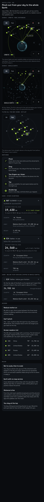

| Part | Rule |
|---|---|
| Your sky (zoom 1) | On the Satellites screen. Directions and heights exact; distances squeezed onto a dome so it fits. |
| Orbits (zoom 2) | True scale. The dome fades and each satellite slides out along its own line to its real place; the Earth shrinks below you. The selected satellite shows its whole orbit as a ring, dashed where the Earth hides it. Labels on the ones in use only. |
| Whole Earth (zoom 3) | True scale, all four fleets. The 14 in view lit as before; every other satellite small, grey, dimmed further when behind the Earth. Faint rings for the three orbit heights; the geostationary belt as a dashed cyan ring. Only the selected one is labelled. Tapping one below the horizon opens its card in the below-horizon state. |
| Below your horizon | Card says `below your horizon`, why in words (`On the far side of the Earth, so its signal can't reach this phone`), when it rises and where, distance through the Earth, country and orbit. |
| Tilted flat | Two-finger tilt all the way down, or `Flat`, shows the original sky plot. |
| Gestures | Pinch, drag, two-finger tilt, tap, double tap; also `− +`, compass, recentre buttons for anyone who can't pinch. |
| Reduce motion | No drift or momentum; zoom jumps between the three levels; positions still update once a second without easing. |
| Screen readers | The 3D view is one image with a summary (`14 satellites in view, 10 in use. G12 selected, 21,140 km away.`). Under it, a list of satellites by height, highest first, each row opening the card. |
| Data rules | No map service and no network for the Earth: a low-detail land outline ships with the app. Nothing about your position leaves the phone. Sample craft names, years and weights on the boards are placeholders for the table. |

## Satellites in 3D: re-work (hand-off 45)

User, 8 Nov, after seeing h42 on phones. Supersedes the sizes, lines and chip placement above; zoom levels, gestures and card stay.

| Part | Rule |
|---|---|
| Box | Full width, edge to edge (no side margin, hairlines top and bottom). 470 tall on Your sky, 420 on Orbits and Whole Earth. At every level the camera fits the whole Earth plus what that level shows; nothing of the Earth is cut off. |
| Dome | Radius 1.55 × the Earth's (was 0.55), on your horizon plane. Camera 7° above the horizon, looking north. Low satellites sit beside the Earth, never on it. |
| Under the box | Level chip (`YOUR SKY` + dots) left, `Dome not to scale · distances are real` right (Orbits and Whole Earth: `True scale`). Tour caption below it. Then the legend. |
| The tour | Nothing tapped: one satellite's path at a time. Pick a satellite in use at random (never the one just shown; in-view ones join if fewer than 3 are in use). Each stays **6 s**. Switch: old path fades out 400 ms, new path draws rise → set over 800 ms, the pill `C21 · its path across your sky` slides to the new satellite (clamped inside the box). Caption under the box: a 6 s countdown ring, `Showing C21 · next in 4 s · tap a satellite to keep one`. Turning, tilting, pinching don't reset the clock. |
| The path | Your sky: where the satellite's orbit crosses your sky. Dotted since it rose (`rose 2 h 13 m ago` at the horizon end), solid with an arrow from the satellite to where it sets (`sets in 2 h 43 m`). Orbits and Whole Earth: the same satellite's whole orbit, dotted behind the Earth. The orbit plane is inferred (tilt + heading north/south); if it flips in the first minute, cross-fade like a switch. |
| Tap | Tour stops. Only that satellite's path; its pill becomes the distance tag (`21,140 km`, to its left); card opens below. Tap another satellite to switch. |
| × or tap empty sky | Card closes; the path stays 3 s, then the tour resumes with a different satellite. |
| Reduce motion / screen readers | No tour: the highest satellite's path stays until you tap another; changes are instant. Screen readers read the list. |
| Kept from the user's h42 changes | Flat only from its switch; no snap after pinch or turn; flag emoji on the card's **Built in** row (Galileo: United Kingdom, Germany; run by the EU Space Programme). |
| Whole Earth | Grey rest-of-fleet needs the h44 orbit data; until then only the satellites in view. |

## Satellites states

| State | Verdict |
|---|---|
| Very accurate (total under 1 ms) | `Your phone's GPS clock is accurate to about ±200 µs. Nothing is holding it back.` Accent tick, not amber; **no row is tagged LIMIT** and the bars are neutral grey. Asked for by Claude Code (Galaxy A16, 2 Nov). |
| Chip is the limit | See Satellites (the Moto G32 case: ±10 ms with 9 to 15 satellites) |
| Signal is the limit | `Timing is limited by the satellite signal: about ±400 µs.` More satellites or a clearer sky will help |
| Silver link | `Your phone links GPS time to its clock less directly: about ±2 ms.` More satellites won't change it |
| No raw clock reports | `This phone's GPS chip doesn't share its clock.` Brocast uses internet time instead; the sky still shows, but Use satellites can't improve timing on this phone |

## Stereo pair

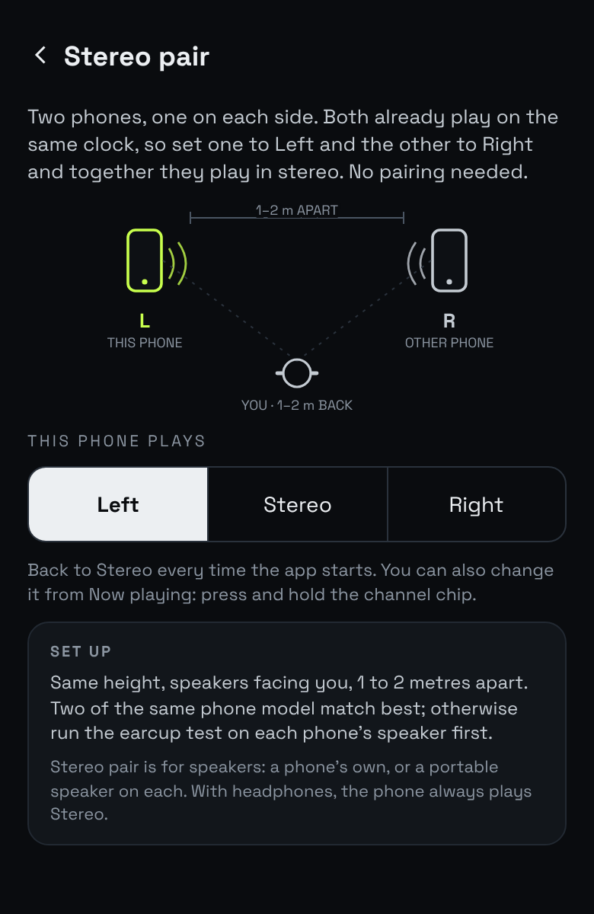

The user's decisions (4 Nov): two phones make stereo by one playing Left and the other Right. **No pairing:** each phone plays its own channel off flowtime, which is accurate enough (listeners already hear stereo speakers at varying distances). The channel options are **Left, Stereo, Right**; "Both" is renamed **Stereo**. Every app start is **Stereo**.

| Element | Shows | Status |
|---|---|---|
| Intro | Two phones, one each side, already on the same clock; no pairing needed | |
| Picture | `L` this phone and `R` the other phone, the listener in front, `1–2 m APART` and `1–2 m BACK` | |
| This phone plays | Segmented: Left, Stereo, Right. Stereo after every app start. With headphones, locked to Stereo. | now (Test bench has the split) |
| Note | Back to Stereo every start; also changeable from Now playing by press and hold | |
| Set up | Same height, facing you, 1–2 m apart; same model matches best, otherwise run the earcup test on each phone's speaker | |

Dropped (user, 4 Nov): the partner card, pairing, the stereo image bar, the fall-back to Both, and the states that relied on them.

## Channel control

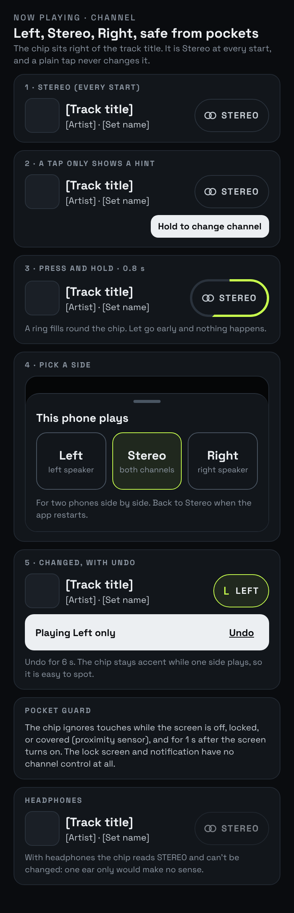

On Now playing, right of the track title. **Protected against pocket taps.**

| Step | Shows | Rule |
|---|---|---|
| 1 · Stereo | A neutral outline chip: two overlapping rings and `STEREO` (44 px tall) | Every app start |
| 2 · A tap | A hint bubble, `Hold to change channel`, for 2 s; nothing changes | A plain tap never changes the channel |
| 3 · Press and hold | An accent ring fills round the chip over **0.8 s**; let go early and nothing happens | Haptic tick when full |
| 4 · Pick a side | A bottom sheet, `This phone plays`, with three large buttons (Left, Stereo, Right, 76 px tall), the current one in accent | Swipe down or tap outside to cancel |
| 5 · Changed | The chip turns accent: `L LEFT` or `R RIGHT`; a toast `Playing Left only` with **Undo** for 6 s; an event `Channel changed to Left: until the app restarts` | |
| Pocket guard | Touches are ignored while the screen is off, locked or covered (proximity sensor), and for 1 s after the screen turns on. The lock screen and notification have no channel control. | |
| Headphones | Chip dimmed, `STEREO`, not changeable | |

## Artist photo

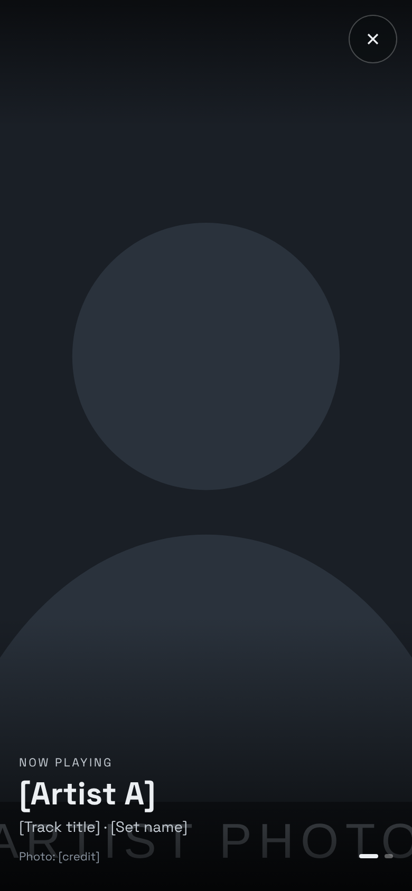

The user's request (4 Nov): a photo of the artist shows while their music plays, tap to enlarge to full screen. Exported screens in this repo show a placeholder instead of the real photos; the real ones are on the design canvas.

| Element | Shows | Taps |
|---|---|---|
| Photo | Fills the screen (cover), on black, centred on the focus point | Tap anywhere or swipe down to close |
| Close | A 44 px round × top right, on a translucent dark disc | Closes |
| Caption | Over a dark gradient at the bottom: `NOW PLAYING`, the artist name (30 px bold), `track · set`, the photo credit, and dots when the artist has more than one photo | Swipe sideways for the next photo |

It follows the track: if the artist changes while open, the viewer cross-fades to the new artist. Screen levels: Full and Reduced show it; Minimal and Off don't. The lock screen and notification keep the sync picture as their artwork; the artist name is in their text.

## Artist names

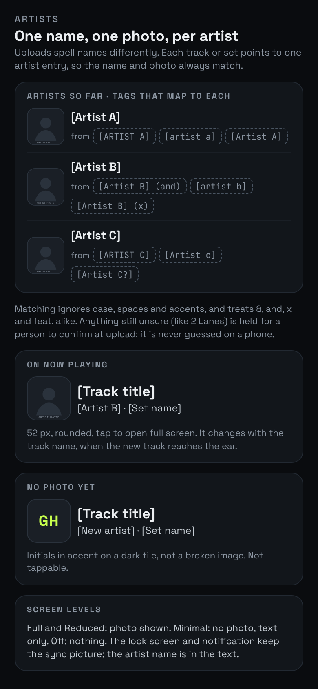

Every track or set points to **one artist entry**: a canonical name, its photos with focus points and credits, and the tags that map to it. Uploads spell names differently, so ingest matches tags case-insensitively, ignoring extra spaces and accents, and treating `&`, `and`, `x` and `feat.` alike. Anything still unsure (for example a number spelled as a digit) is held for a person to confirm at upload, never guessed on a phone. Artists so far: three. Their names and photos are kept out of this repo (the user's decision, 4 Nov); the user holds them.

## Data and sharing

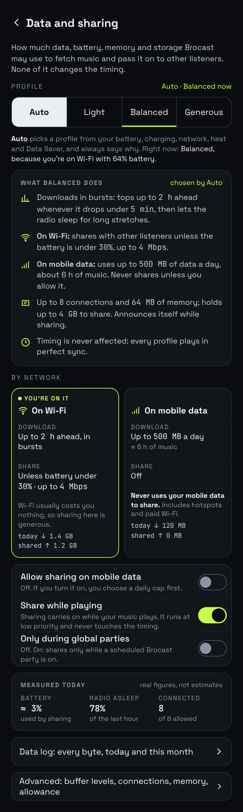

From the Pears spike (7 Nov), the user's decisions: resource **profiles**; **sharing per network** (Wi-Fi generous, mobile data never unless chosen, with its own daily cap); **Share while playing**, on by default. The user asked for detailed descriptions so listeners understand the behaviour. Settings and ranges: `docs/pears-spike-design.md` §6 on the `pears-spike` branch. Opens from Settings › Delivery › Data and sharing.

| Element | Shows | Status |
|---|---|---|
| Intro | `How much data, battery, memory and storage Brocast may use to fetch music and pass it on to other listeners. None of it changes the timing.` | |
| Profile | Segmented: Auto, Light, Balanced, Generous. With Auto, the profile Auto picked is underlined in accent, and the label top right says `Auto · Balanced now` | later |
| Auto explained | One sentence, then the reason now: `Right now: Balanced, because you're on Wi-Fi with 64% battery` | later |
| What it does | A card for the profile in force, five lines with icons: downloading (bursts and buffer levels), on Wi-Fi, on mobile data, connections, memory and allowance, and `Timing is never affected`. Exact figures per profile below. | later |
| By network | Two columns, **On Wi-Fi** and **On mobile data**. The one the phone is on has an accent border and `● YOU'RE ON IT`. Each: DOWNLOAD and SHARE in words, one line on why, and today's real figures (`today ↓ 1.4 GB · shared ↑ 1.2 GB`). Mobile says `Never uses your mobile data to share. Includes hotspots and paid Wi-Fi.` while its sharing is off. | later |
| Switches | `Allow sharing on mobile data` (off; turning it on opens the daily-cap sheet first), `Share while playing` (on), `Only during global parties` (off) | later |
| Measured today | Battery used by sharing (`≈ 3%`), radio asleep (share of the last hour), connected of allowed. Real figures, labelled so. | later |
| Data log | A link row: `Data log: every byte, today and this month`. Opens Data log | later |
| Advanced | A link row: buffer levels, connections, memory, allowance. Opens Advanced | later |

**Profile figures** (Balanced is the default):

| | Light | Balanced | Generous |
|---|---|---|---|
| Downloads | Bursts; top up to 15 min when under 2 min | Top up to 2 h when under 5 min | Top up to 24 h when under 30 min |
| On Wi-Fi | Shares only while charging, up to 1 Mbps | Shares unless battery under 30%, up to 4 Mbps | Always shares, no speed limit |
| On mobile data | Downloads up to 100 MB a day; never shares | Up to 500 MB a day; never shares unless allowed | No daily limit; never shares unless allowed |
| Connections, memory, allowance | 4, 24 MB, 1 GB; finds peers but doesn't announce | 8, 64 MB, 4 GB; announces while sharing | 24, 192 MB, 10 GB; always announces |

## Data and sharing states

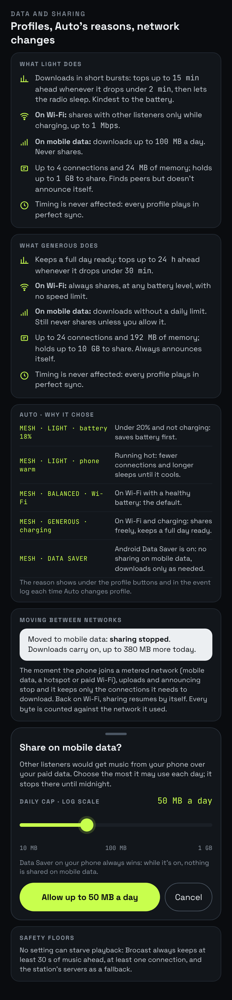

| State | Shows |
|---|---|
| Light, Generous | Their What it does cards |
| Auto's reasons | The chip Auto shows, and why: `MESH · LIGHT · battery 18%` (under 20%, not charging), `MESH · LIGHT · phone warm`, `MESH · BALANCED · Wi-Fi`, `MESH · GENEROUS · charging` (Wi-Fi and charging), `MESH · DATA SAVER` (no sharing on mobile data). Shown under the profile buttons and logged as an event when Auto changes profile. |
| Moving between networks | A toast: `Moved to mobile data: sharing stopped. Downloads carry on, up to 380 MB more today.` Back on Wi-Fi, sharing resumes by itself; every byte is counted against the network it used. |
| Share on mobile data? | A sheet before opting in: why it costs paid data, a daily cap on a **log scale** from 10 MB to 1 GB (default 50 MB), that it stops at the cap until midnight, and that Data Saver always wins. `Allow up to 50 MB a day`, Cancel. |
| Safety floors | No setting can starve playback: always at least 30 s ahead, one connection, and the station's servers as fallback. |

## Data and sharing: advanced

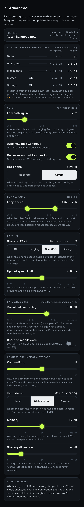

Every engine setting from `docs/pears-spike-design.md` §6, with what it costs. Opens from Data and sharing › Advanced. Each row: name, value top right (mono), the control, one plain sentence on what it does and what it costs.

| Element | Shows | Status |
|---|---|---|
| Profile | `Auto · Balanced now`, and `Change any setting below and the profile becomes Custom` | later |
| Cost of these settings · a day | Battery, Wi-Fi data, Mobile data, Memory, Storage. Each: PREDICTED (outlined bar) and TODAY (a line, real figures). Predicted comes from this phone's own last 7 days. A line and its figure go amber when today runs more than 25% over. Updates while dragging. | later |
| AUTO | Low battery line (10 to 50%, 20%; Auto leaves Light 10 points higher); Auto may pick Generous (on); Generous only while charging (on); Hot phone: Moderate or Severe (Severe) | later |
| DOWNLOADING | Keep ahead: a two-thumb range on a log scale, 30 s to 24 h (5 min → 2 h). Low thumb = refill point, high thumb = refill to. | later |
| ON WI-FI | Share on Wi-Fi: Off, Charging, Over 30%, Always (Over 30%). Upload speed limit, log, 0.25 Mbps to no limit (4 Mbps) | later |
| ON MOBILE DATA | Download limit a day, log, 10 MB to no limit (500 MB). Share on mobile data (off; turning on opens the daily-cap sheet) | later |
| CONNECTIONS, MEMORY, STORAGE | Connections, log₂, 2 to 32 (8). Be findable: Never, While sharing, Always (While sharing; this is DHT announce). Memory, log, 16 to 256 MB (64). Sharing allowance, 0 to 20 GB (4) | later |
| Can't go lower | The floors: 30 s ahead, one connection, station servers; no setting touches the timing | |

Values shown are Balanced's. Every slider snaps to the steps on its tick labels and reads its value aloud (`aria-valuetext`).

## Data and sharing: advanced states

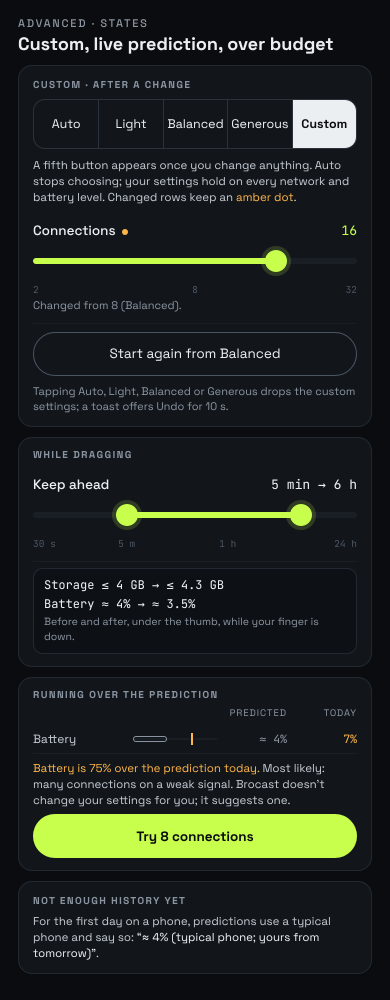

| State | Shows |
|---|---|
| Custom | Changing any setting adds a fifth profile button, **Custom**, and selects it. Auto stops choosing. Changed rows get an amber dot and `Changed from 8 (Balanced)`. `Start again from Balanced` resets. Tapping another profile drops Custom, with a 10 s Undo toast. |
| While dragging | A before → after box under the control for each cost that moves: `Storage ≤ 4 GB → ≤ 4.3 GB`, `Battery ≈ 4% → ≈ 3.5%`. |
| Running over the prediction | The amber line, `Battery is 75% over the prediction today`, the likely cause, and one suggested change as a button (`Try 8 connections`). Brocast never changes settings by itself here. |
| Not enough history yet | First day on a phone: predictions use a typical phone and say so: `≈ 4% (typical phone; yours from tomorrow)`. |

## Block provenance

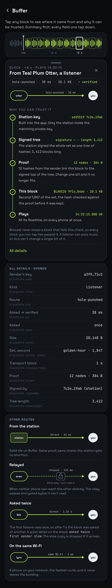

Tap any block tile on Buffer (near zone, 44 px target including its column) and a sheet rises. Summary first, every field one tap down. Fed by `blockInfo` (`docs/engine-api.md` §6, pears-spike branch). The selected tile gets a white ring; tap another tile to switch.

| Element | Shows | Source |
|---|---|---|
| Eyebrow | `BLOCK · +8 s · PLAYS 14:32:15` | `g`, flowtime |
| Title | `From <nym>, a listener`, or `From the station` | `from`, `peer` → nym |
| Chips | route, time, size, `✓ verified` (accent) | `via`, `ms`, `bytes`, `verified` |
| Route | Sender → you. Listener: rounded pill; station: solid tile, matching Buffer's tiles. Line labelled `<route> · <ms>`. Relayed: dashed line through a padlock box, `blind relay · can't read it`. Routes: `same Wi-Fi` (lan), `direct`, `hole-punched`, `relayed`. | `via`, `ms` |
| Why you can trust it | A chain of five ticked steps: Station key (`ed25519 7c2e…19ab`, built into the app), Signed tree (signature ✓, length), Proof (nodes, bytes), This block (BLAKE2b, size), Plays (flowtime). One plain sentence each. | `signedBy`, `treeLength`, `proof`, hash, `g` |
| Footnote | `Brocast never keeps a block that fails this check…` | |
| All details | Expands to every field with its engine name in small mono under it: sender's key, kind, route, asked → verified, size in bytes, set and second, transport block, proof, signed by, tree length | `blockInfo` |

There is no "unverified" state to design: an unverified block is never stored. Station blocks get the same chain ("the station gets no shortcut"). Played blocks can't be tapped (they're consumed). Reduced motion: the sheet fades instead of rising.

## Data log

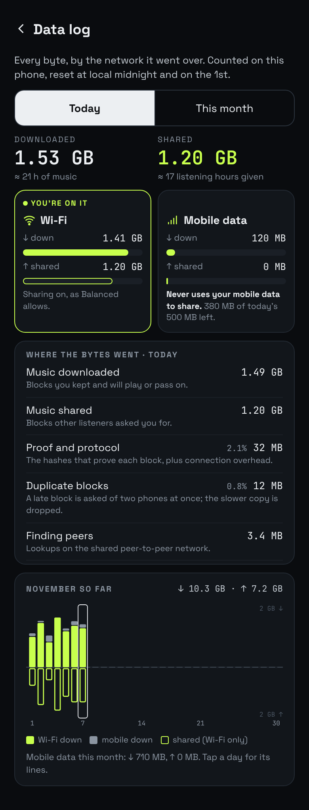

Every byte by the network it went over. Opens from Data and sharing › Data log. Today or This month (segmented; resets at local midnight and on the 1st). Fed by `ledger`.

| Element | Shows | Source |
|---|---|---|
| Totals | DOWNLOADED `1.53 GB` `≈ 21 h of music`; SHARED (accent) `1.20 GB` `≈ 17 listening hours given`. Hours at 72 MB an hour (160 kbps). | `ledger.today.*` |
| By network | Wi-Fi and Mobile data cards, the current one with `● YOU'RE ON IT`. ↓ down (solid bar) and ↑ shared (outline bar), same scale in both. Mobile: `Never uses your mobile data to share.` while off, and what's left of today's cap. | `ledger.today.wifi`, `.metered`, `network.kind` |
| Where the bytes went | Music downloaded, Music shared, Proof and protocol (% and MB), Duplicate blocks (% and MB, with why), Finding peers (MB). One plain line each. | `downBytes`, `upBytes`, `overheadPct`, `duplicatePct`, `dhtBytes` |
| Month so far | Day bars: downloaded above the line (Wi-Fi accent, mobile grey stacked on top), shared below as outlines. Today framed. Days to come as dots. Totals top right; mobile total in words under it. Tap a day for its lines. | `ledger.month`, daily history |

This month view: the same cards and lines for the month, chart unchanged.

## Identity wizard (first run)

From `docs/keys.md` (pears-spike branch). Runs once, before First use · sharing. Six steps with a segmented progress bar and `YOUR IDENTITY · n OF 6 · STEP` at the top. Fed by `makeSeed`'s `report`: source names and byte counts only, never values. No Pears name or logo.

| Step | Screen | Shows |
|---|---|---|
| 1 Welcome | 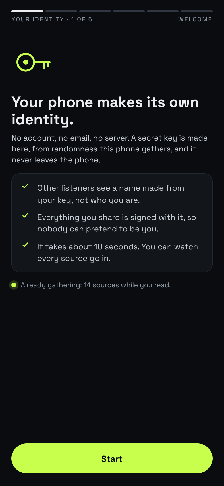 | Key glyph; `Your phone makes its own identity.`; no account, email or server; key never leaves the phone. Three ticked lines (name from your key, everything signed, ~10 s). Live line `Already gathering: N sources while you read` (sensors sample during this screen). Start. |
| 2 Gathering | 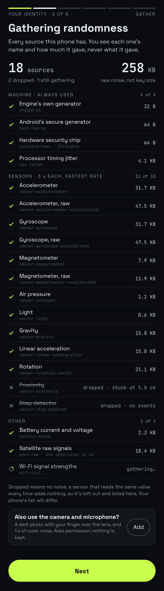 | Big counts: sources (ok + gathering) and KB of raw noise (`raw noise, not key size`). Groups MACHINE · ALWAYS USED, SENSORS · 3 s EACH, OTHER, each with `n of m`. One 36 px row per source: tick / spinner / ✕, plain name, engine id in small mono, bytes. Dropped rows struck through: `dropped · stuck at 5.0 cm`, `dropped · no events`. Sensors the phone lacks aren't listed. The list grows to any length (15 to 25 typical) and scrolls; Next stays pinned. Camera and microphone: an Add card. |
| 3 Add yours | 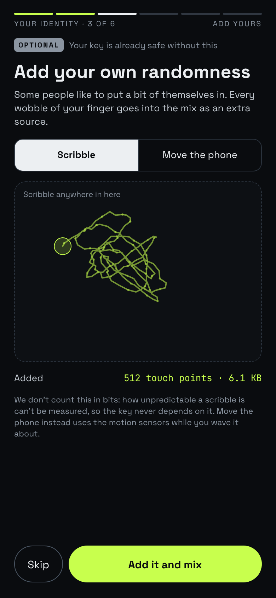 | `OPTIONAL · Your key is already safe without this`. Scribble or Move the phone. Scribble pad shows a fading trail. `Added  512 touch points · 6.1 KB`. Never a bit count. Skip / Add it and mix. |
| 4 Mixing | 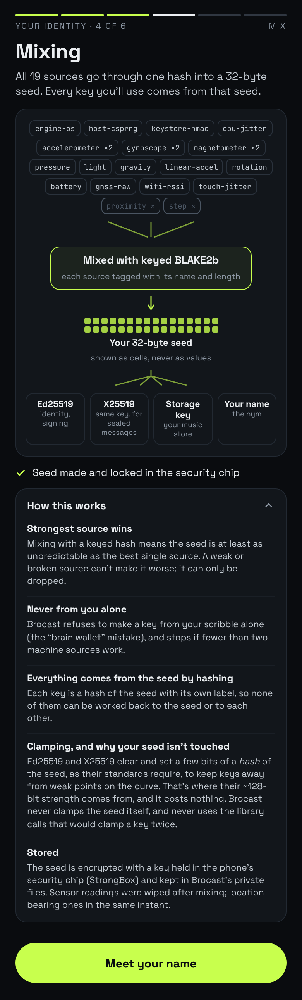 | Source chips (dropped ones dim with ✕) → `Mixed with keyed BLAKE2b` → 32 cells `Your 32-byte seed · shown as cells, never as values` → Ed25519, X25519 (same key), Storage key, Your name. `✓ Seed made and locked in the security chip`. **How this works** (expandable): strongest source wins; never from you alone; everything from the seed by hashing; clamping, and why the seed isn't touched; stored. |
| 5 Your name | 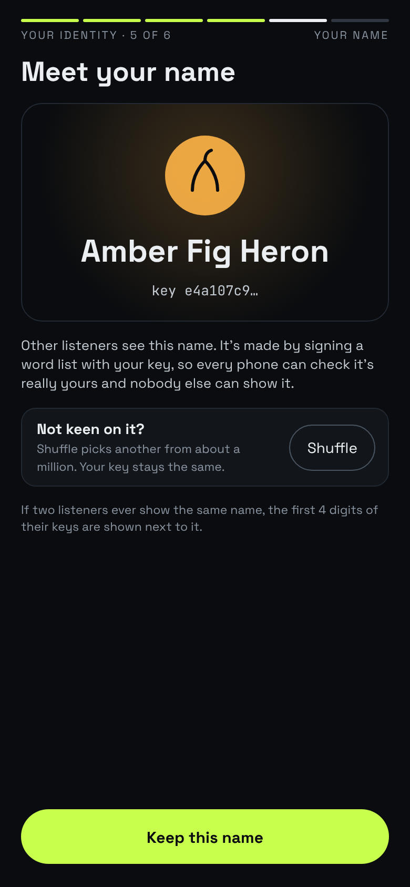 | Nym large on its colour, `key e4a107c9…` (first 8 hex). One line on why it's verifiably yours. Shuffle (keeps the key). Same-name rule: 4 hex digits shown. Keep this name. |
| 6 Back up | 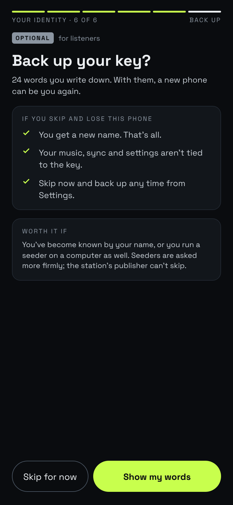 | Listener: `OPTIONAL`; what losing the phone costs (only a new name); Skip for now / Show my words. Then straight to First use · sharing. |

### Identity · back up states

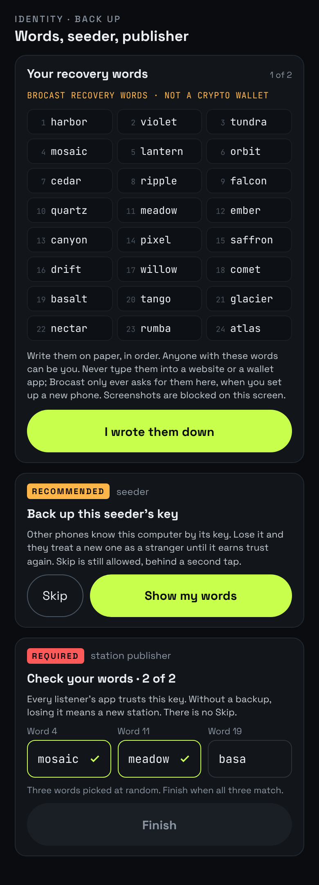

| State | Shows |
|---|---|
| Words (1 of 2) | 24 words in a 3-column numbered grid, `BROCAST RECOVERY WORDS · NOT A CRYPTO WALLET` in amber, warning (anyone with them is you; never into a website or wallet). `FLAG_SECURE`: no screenshots. I wrote them down. |
| Seeder | `RECOMMENDED` chip; why (peers know the computer by its key). Skip needs a second tap. |
| Publisher | `REQUIRED` chip; check 2 of 2: three random word positions, each field ticks when right; Finish disabled until all three match. No Skip. |

### Identity · gathering states

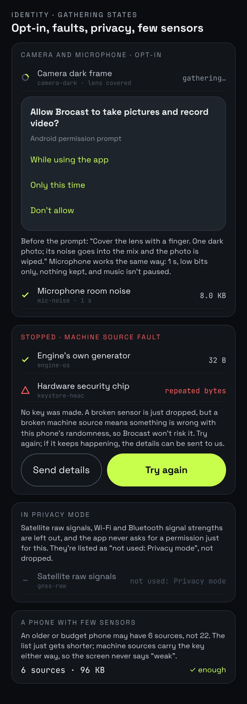

| State | Shows |
|---|---|
| Camera and microphone | Before the prompt, one line on what's taken (cover the lens; 1 s of room noise, low bits, nothing kept, music not paused). Then Android's prompt. Each becomes a row. |
| Machine source fault | `STOPPED · MACHINE SOURCE FAULT` in red, the faulty row with ▲ and the fault (`repeated bytes`), why sensors are dropped but this stops it. Send details / Try again. Also covers `NEED_MACHINE_SOURCE`. |
| Privacy mode | GNSS, Wi-Fi and Bluetooth rows shown with a dash, `not used: Privacy mode` (not struck through: not a fault). |
| Few sensors | `6 sources · 96 KB  ✓ enough`. The screen never says weak. |

### Identity · desktop seeder

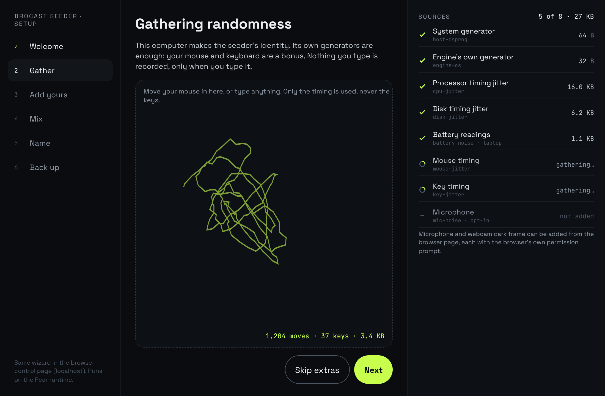

The same six steps as a left rail, the step in the middle, sources on the right. Gathering: a mouse-and-typing pad (`Only the timing is used, never the keys`; `1,204 moves · 37 keys · 3.4 KB`). Sources: system generator, engine, CPU and disk timing jitter, battery (laptops), mouse timing, key timing; microphone and webcam opt-in from the browser control page with the browser's prompt. The browser control page uses the same layout.

## Beat counter states

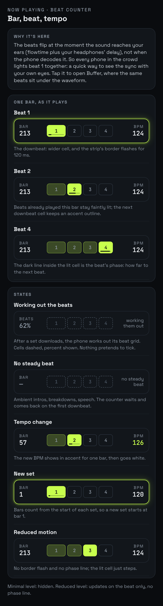

One bar as it plays (beats 1, 2, 4), then: working out the beats, no steady beat, tempo change, new set, reduced motion. Rules are in the Now playing table.

## Kept

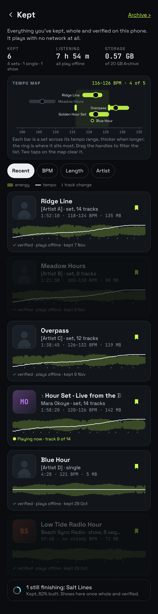

Opens from the Kept bookmark on Now playing's artist photo (user, 7 Nov). Everything whole and verified on this phone (`library.sets[].state = built`; in the beta, everything is kept), with what makes each one itself. `Archive ›` top right for the date-ordered list and storage.

| Element | Shows | Source | Status |
|---|---|---|---|
| Summary | KEPT count (and by kind), LISTENING total time (`all play offline`), STORAGE (of the Archive limit) | Library | now |
| Tempo map | One bar per item across its BPM range (low to high), thickness by length, a ring at the BPM it sits at most, name beside it. A two-handle range filters the list (`116–126 BPM · 4 of 5`); items outside dim to 32%. Items with no steady tempo aren't on the map. Two taps clear it. Bars still being analysed are dashed. | SetBeats per item | later |
| Sort | Recent (kept date), BPM, Length, Artist | | |
| Legend | energy, tempo, track change | | |
| Long names | A name that doesn't fit on one line waits 1.5 s, scrolls left at 30 px/s with faded edges, loops with a 40 px gap, pauses under a finger, stops after 3 loops until next on screen. Reduced motion: ellipsis; full name on the opened card. Same for track names (user, 8 Nov). |
| Card | Artist thumbnail (56 px; photo at its focus point, or initials on a tinted tile), title, `artist · set, 14 tracks`, mono `1:52:10 · 118–124 BPM · 135 MB`, bookmark (44 px). Under it the **fingerprint**: the whole file's energy as a band (waveform summary), its tempo as a white line (beat grid), track changes as ticks (cue list). Footer `✓ verified · plays offline · kept 7 Nov`, or `● Playing now · track 9 of 14` in accent. | File record, waveform summary, SetBeats, cue list | later |
| Still finishing | A dashed row: `1 still finishing: Salt Lines · Kept, 62% built. Shows here once whole and verified.` | Library | now |

## Kept states

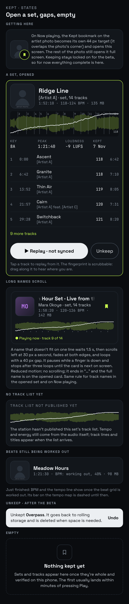

| State | Shows |
|---|---|
| Getting here | The bookmark on the photo is a 44 px target overlapping its corner; the rest of the photo still opens it full screen. |
| A set, opened | Tap a card: 72 px thumbnail, a 72 px fingerprint with numbered track lines and the BPM range at its edge (drag along it to scrub), KEY · PEAK · LOUDNESS · KEPT, the track list (number, start time, title, track artist, BPM, length; the first 5, then `9 more tracks`), Replay · not synced (as Archive), Unkeep. Tap a track to replay from it. |
| No track list yet | Fingerprint without ticks, `TRACK LIST NOT PUBLISHED YET`, and why. |
| Beats still being worked out | `BPM: working out, 40%`; dashed bar on the tempo map; no tempo line. |
| Unkeep (after the beta) | Toast with Undo: back to rolling storage, deleted when space is needed. |
| Empty | Dashed tile and one line: items appear once whole and verified. |

KEY and LOUDNESS need analysis that doesn't exist yet; hide them until it does.

## Track ID review (station, desktop)

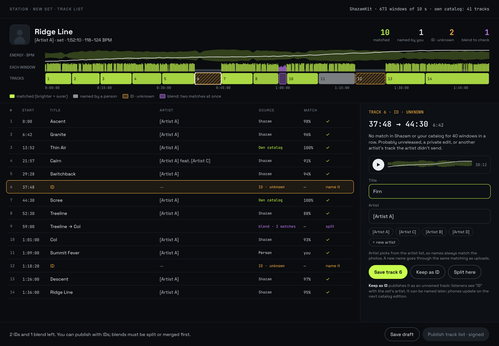

For the ShazamKit trial and, if it works, adding each new set (backlog). Runs where ShazamKit runs (a Mac or an Android device), never on listeners' phones. 1440 wide.

| Element | Shows |
|---|---|
| Header | `STATION · NEW SET · TRACK LIST`; right: the run (`ShazamKit · 673 windows of 10 s · own catalog: 41 tracks`). |
| Set | Thumbnail, title, artist · kind · length · BPM range; counts: matched (accent), named by you (white), ID · unknown (amber), blend to check (purple). |
| Lanes, one time axis | ENERGY · BPM (the set's fingerprint); EACH WINDOW (one bar per 10 s window: accent height = match confidence, grey = no match, purple = two matches); TRACKS (segments, brighter = surer; unknown hatched amber; blend purple; named by a person grey-white; selected = white outline). |
| Table | #, start, title (`ID` in amber when unknown), artist, source (Shazam / Own catalog / Person / `ID · unknown` / `blend · 2 matches`), match %, action (✓, `name it`, `split`). The selected row is outlined. |
| Side panel | The selected segment: times and length, why it's unknown, a player over its fingerprint, Title, Artist (picked from the artist list, chips for each artist plus `+ new artist`), Save, **Keep as ID**, Split here. |
| Footer | What's left; Save draft; **Publish track list · signed** (signed with the station key), disabled until every blend is split or merged. IDs may be published. |

## Track names on the phone

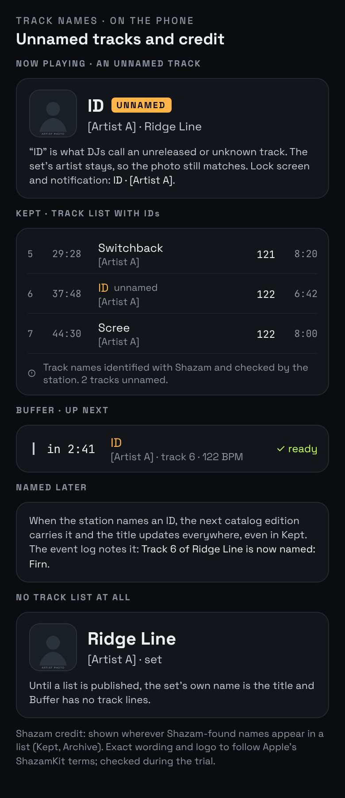

| State | Shows |
|---|---|
| Unnamed track playing | Title `ID` with an amber `UNNAMED` tag, `artist · set`. Lock screen and notification: `ID · artist`. |
| Kept track list | ID rows: `ID` in amber, `unnamed`, the set's artist, BPM and length still shown. Footer credit: `Track names identified with Shazam and checked by the station. 2 tracks unnamed.` |
| Buffer Up next | `ID` in amber, `artist · track 6 · BPM`. |
| Named later | The next catalog edition carries the name; it updates everywhere, and the event log says `Track 6 of Ridge Line is now named: Firn`. |
| No track list | The set's name is the title; Buffer has no track lines. |

Shazam credit wording and logo follow Apple's ShazamKit terms, checked in the trial.

## Camera test card

| Setup | Between flashes | Flash frame | Rules |
|---|---|---|---|
| 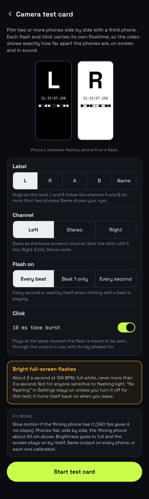 | 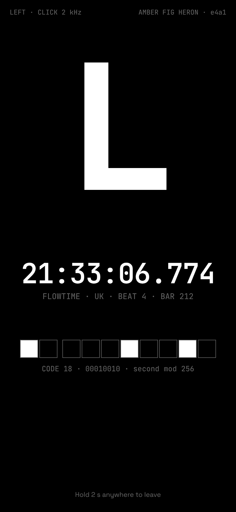 | 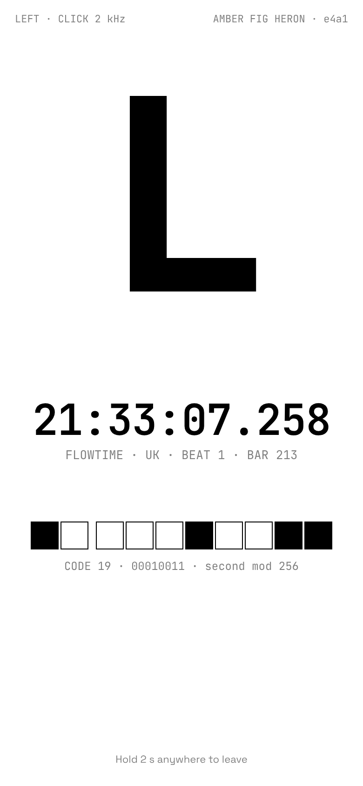 | 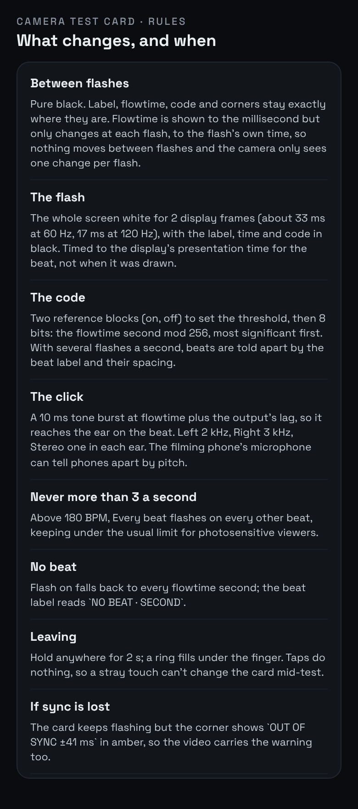 |

User, 7 Nov: a full-screen card filmed by a third phone (slow motion if it can) to time each phone's screen flash and sound. Entry: Settings › Calibration › a row `Camera test card · film phones side by side`.

**Setup:** Label (L, R, A, B, Name; huge on the card), Channel (Left, Stereo, Right; the home screen's channel), Flash on (Every beat, Beat 1 only, Every second), Click (on: 10 ms tone burst). An amber warning about bright flashes; filming tips; Start test card.

**The card**, 390 × 844, nothing moves between flashes:

| Element | Shows |
|---|---|
| Corners (11 px mono, 40% white/black) | `LEFT · CLICK 2 kHz` and `nym · 4 hex` |
| Label | 300 px bold, centred top (`L`) |
| Flowtime | 46 px mono, to the millisecond, the time **of the last flash** (`21:33:07.258`); changes only at a flash |
| Beat line | `FLOWTIME · UK · BEAT 1 · BAR 213`, or `NO BEAT · SECOND` |
| Code | 10 blocks of 30 px: two references (on, off), then 8 bits of the flowtime second mod 256, most significant first; `CODE 19 · 00010011 · second mod 256` under it |
| Leave hint | `Hold 2 s anywhere to leave` |

| Rule | Detail |
|---|---|
| Between flashes | Pure black, white content. |
| Flash | Whole screen white for 2 display frames (≈33 ms at 60 Hz, 17 ms at 120 Hz), content in black; scheduled to the display's presentation time for the beat (Choreographer), not draw time. |
| Click | 10 ms burst at flowtime + output lag. Left 2 kHz, Right 3 kHz, Stereo: 2 kHz left ear and 3 kHz right. |
| Rate cap | Never more than 3 flashes a second: above 180 BPM, every other beat. |
| No flashing setting | Stays on unless turned off for this test; it turns itself back on when the card closes. |
| Screen | Full brightness, kept on, system bars hidden. Taps do nothing; hold 2 s (a ring fills) to leave. |
| Out of sync | The corner shows `OUT OF SYNC ±41 ms` in amber; the card keeps going so the video records it. |

## Stations

| Directory | Station page | States |
|---|---|---|
| 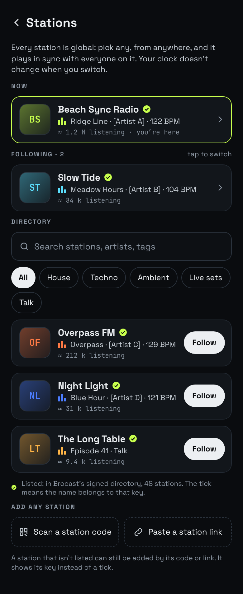 | 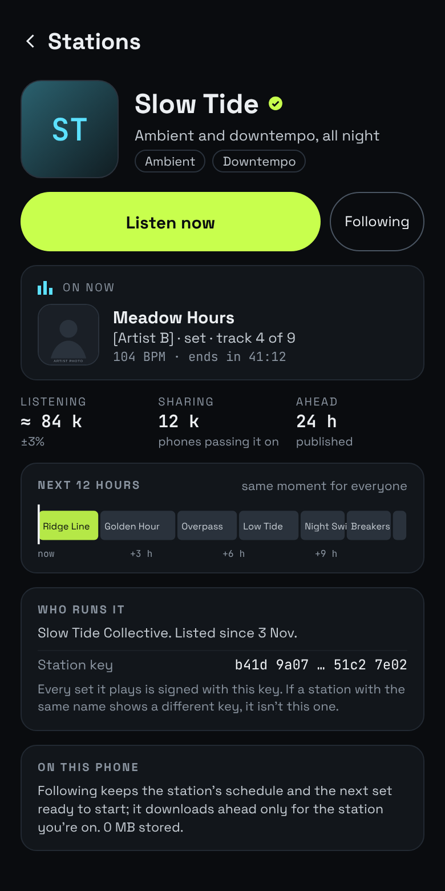 | 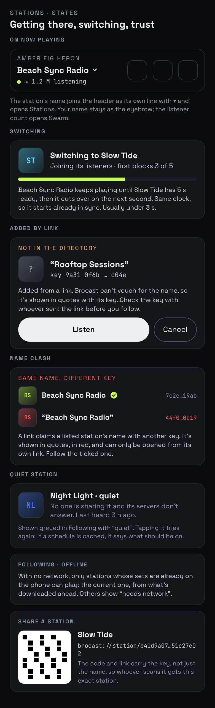 |

Your 13:48 ASK; design §11a: every station is a public key, global, no local-only mode; a phone can follow any number.

**Entry:** on Now playing the station name becomes its own header line (`Beach Sync Radio ▾`, 15 px bold) under your nym, and opens Stations. The listener count line under it still opens Swarm. (Proposal: the header gains one line.)

| Stations element | Shows |
|---|---|
| Intro | Global, in sync, the clock doesn't change when you switch. |
| NOW | The current station, accent border: tile (initials on its colour until stations have art), name, ✓ if listed, now playing with BPM, `≈ 1.2 M listening · you're here`. |
| FOLLOWING | Followed stations, same row; tap to switch. |
| DIRECTORY | Search (stations, artists, tags), tag chips, rows with Follow. Footer: `Listed: in Brocast's signed directory, 48 stations. The tick means the name belongs to that key.` |
| ADD ANY STATION | Scan a station code; Paste a station link. Unlisted stations show their key instead of a tick. |

| Station page | Shows |
|---|---|
| Header | 84 px tile, name, ✓, tagline, tags; Listen now; Following |
| On now | Artist photo, title, artist · set · track n of m, BPM, ends in |
| Figures | LISTENING (≈, ±3%), SHARING (phones passing it on), AHEAD (published) |
| Next 12 hours | Schedule blocks from now, the current one in accent; `same moment for everyone` |
| Who runs it | Operator line, listed date, station key in groups of 4 hex, one line on what the key means |
| On this phone | Following keeps schedule and next set ready; downloads ahead only for the station you're on |

| State | Shows |
|---|---|
| Switching | The old station plays until the new one has 5 s ready, then cuts over on the next flowtime second; progress `first blocks 3 of 5`. |
| Added by link | `NOT IN THE DIRECTORY` (amber), the claimed name in quotes, key, check-with-the-sender line; Listen / Cancel. |
| Name clash | `SAME NAME, DIFFERENT KEY` (red): the listed one with ✓ and its key; the other in quotes with its key in red; opened only from its own link. |
| Quiet | No sharers and no servers answering: greyed, `quiet`, last heard; tap retries; cached schedule says what should be on. |
| Offline | Only the current station plays (from what's downloaded ahead); others say `needs network`. |
| Share | QR plus `brocast://station/<key>`; carries the key, not the name. |

Needs: a signed directory (Brocast key) with name, tagline, tags, colour, operator, listed date per station key; per-station listener estimate and now-playing from each station's catalog.

## Sync view

| Screen | States |
|---|---|
| 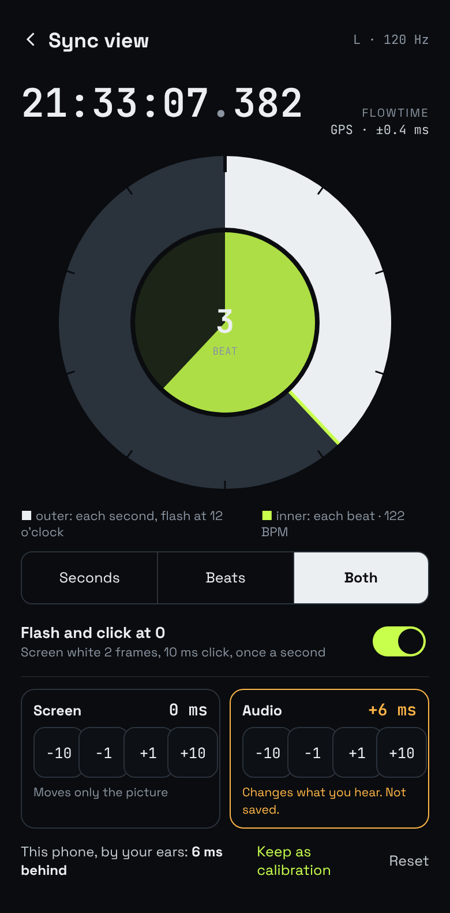 | 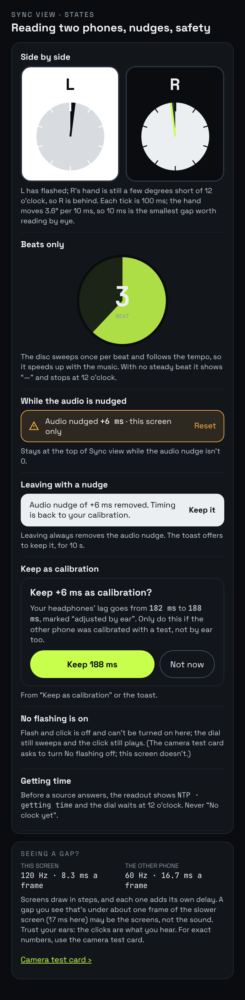 |

Your 2 Nov notes (`ui/SyncScope.kt`). From Settings › Sync view. For checking two phones side by side **by eye and ear**; the camera test card is for exact numbers.

| Element | Shows |
|---|---|
| Header | Back, `L · 120 Hz` (this phone's channel and refresh rate) |
| Readout | Flowtime `21:33:07.382` (34 px mono), source and its error |
| Dial (300 px) | **Outer disc:** white sweeps clockwise from 12 o'clock once per flowtime second, accent hand, 10 ticks (100 ms each, 12 o'clock heavier). **Inner disc:** accent sweeps once per beat, following tempo, beat number in the middle. With no steady beat it shows `—` and waits at 12. |
| Dial choice | Seconds, Beats, Both (default), Line (full-screen line mode, below) |
| Flash and click at 0 | On by default: screen white 2 frames and a 5 ms tick at each second's 12 o'clock (test card pitches). The tick plays only when nothing else is playing; with music on, the music is the sound (built 8 Nov). |
| Nudges | Two boxes side by side, −10 −1 +1 +10. **Screen:** moves only the picture. **Audio:** amber border, `Changes what you hear. Not saved.` |
| Reading | `This phone, by your ears: 6 ms behind` (from the audio nudge's sign), Keep as calibration, Reset |

| State | Shows |
|---|---|
| Side by side | How to read two dials: the one whose hand hasn't reached 12 is behind; 3.6° per 10 ms, so 10 ms is the smallest gap to read by eye. |
| Audio nudged | Amber banner at the top: `Audio nudged +6 ms · this screen only`, Reset. |
| Leaving | Leaving always removes the audio nudge; a toast offers `Keep it` for 10 s. |
| Keep as calibration | Sheet: lag 182 → 188 ms, marked "adjusted by ear", with a caution. |
| No flashing on | Flash off and locked; the dial and click carry on. (The test card asks to turn No flashing off; Sync view doesn't.) |
| Getting time | `NTP · getting time`, dial waits at 12. Never "No clock yet". |
| Seeing a gap? | This phone's refresh rate and frame time, and `In its header` for the other phone (built 8 Nov: no link between phones); a gap under one frame of the slower screen may be the screens, not the sound; trust the clicks; link to the camera test card. |

## Outputs and headphones' names

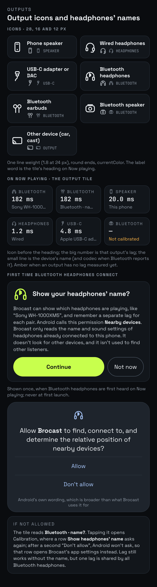

| Element | Shows |
|---|---|
| Icons | Phone speaker, Wired headphones, USB-C adapter or DAC, Bluetooth headphones, Bluetooth earbuds, Bluetooth speaker, Other device. 24 px grid, 1.8 stroke, round ends, currentColor; used at 28, 16 and 12 px. |
| Output tile on Now playing | 12 px icon before the heading (`SPEAKER`, `HEADPHONES`, `USB-C`, `BLUETOOTH`, `OUTPUT`), the output's lag, and the device's name (plus codec for Bluetooth: `Sony WH-1000XM5 · LDAC`). Amber `Not calibrated` when that output has no lag yet. Without permission: `Bluetooth · name?`. |
| First Bluetooth headphones | Once, on Now playing (never at first launch): `Show your headphones' name?` with what it's for and what it isn't (doesn't look for other devices, not used to find listeners); Continue → Android's Nearby devices prompt; Not now. |
| Not allowed | Tile `Bluetooth · name?` opens Calibration, row `Show headphones' name` asks again; after a second refusal it opens app settings. Without the name, all Bluetooth headphones share one lag. |

## First listen

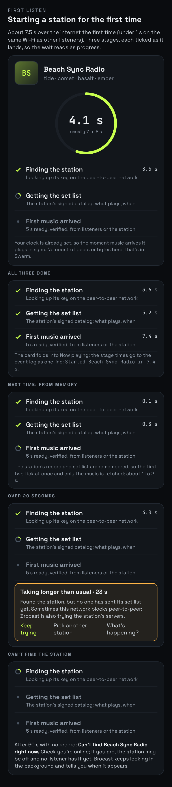

From the Pears step 1 and 2 results (8 Nov): finding a station by key takes about 7.5 s on the public network, under 1 s on a LAN.

| Element | Shows |
|---|---|
| Card | Station tile, name, its key words; a ring with the elapsed time (`4.1 s · usually 7 to 8 s`). |
| Stages | `Finding the station` → `Getting the set list` → `First music arrived` (5 s ready, verified; playback starts here) → `Rest of the sets` (background, `41 of 66 MB`, usually 30 to 70 s on home Wi-Fi). Each ticks with its time; the current one spins; later ones are dim. Engine states: finding station, getting the set list, fetching, all sets held. |
| Playing, rest still coming | The card folds into Now playing at stage 3; stage 4 carries on in Buffer. Event log: `Started Beach Sync Radio in 7.4 s`, then `All sets held · 52 s`. |
| From memory | Cached record and set list tick at once (0.1 s, 0.3 s); only music is fetched, about 1 to 2 s. |
| Over 20 s | Amber box `Taking longer than usual · 23 s`, what's stuck, that the station's servers are being tried; Keep trying, Pick another station, What's happening? |
| Can't find it | After 60 s with no record: `Can't find Beach Sync Radio right now.` plus causes; keeps looking in the background and says when it appears. |

## Mesh moments

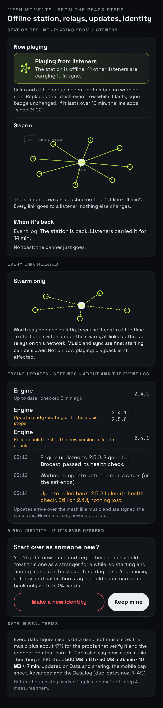

| Moment | Shows |
|---|---|
| Station offline, playing from listeners | Now playing: accent (not amber) banner `Playing from listeners · The station is offline. 41 other listeners are carrying it, in sync.`, in place of the latest-event row; adds `since 21:02` after 10 min. Swarm: station as a dashed outline, `offline · 14 min`. Back: event log `The station is back. Listeners carried it for 14 min.` No toast. |
| Every link relayed | Swarm only, all links dashed, one quiet line: `All links go through relays on this network. Music and sync are fine; starting can be slower.` Not on Now playing. |
| Engine updates | Settings › About row `Engine`: `Up to date · checked 3 min ago`, `Update ready · waiting until the music stops` (amber), `Rolled back to 2.4.1 · the new version failed its check` (amber). Event log lines for updated, waiting and rolled back. Never mid-set, never a pop-up. |
| New identity (only if ever offered) | Warning sheet: new name and key, other phones treat it as a stranger for a while, music/settings/calibration stay, old name back only with its 24 words. `Make a new identity` in red outline; `Keep mine` primary. |
| Data in real terms | All data figures are data used (music + ~17% proofs and connections), with music time at 160 kbps: 500 MB ≈ 6 h, 50 MB ≈ 35 min, 10 MB ≈ 7 min. Battery stays "typical phone" until step 4. |

**Also changed:** Data and sharing (mobile: `uses up to 500 MB of data a day, about 6 h of music`; column `≈ 6 h of music`), the mobile cap sheet (`≈ 35 min of music a day. Real data…`), the network-switch toast (`about 4½ h of music`), Advanced's mobile limit help, the Data log (duplicates `29 MB · 1.9%`, asked of another after 1 s, usually 1–4%), Block provenance (`Asked` field; an "Asked twice" route example: `asked twice · first sender slow`), the station page (key words `tide · comet · basalt · ember` above the hex key), and Stations states (Key renewed: old and new key words, signed by the old key, followed automatically; and a key change not signed by the old key, treated as unlisted in red).

## Swarm with real numbers

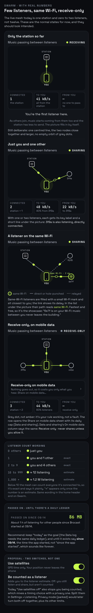

The live mesh (8 Nov) is one station and zero to two listeners. These are the normal states for now.

| State | Shows |
|---|---|
| Only the station so far | Status `RECEIVING`. Station and you, larger and close together, one link; stats `1 · the station`, `41 kB/s · all from the station`, `— · no one to pass to`; centred `You're the first listener here.` and one line on what happens as others join. No empty orbit of grey dots. |
| You and one other | Status `SHARING`. Station, you, `3f9a`, links both ways; one line under the picture: `3f9a is also listening, directly connected.` |
| Same Wi-Fi | Path `lan`: the peer filled (accent 15%) with a small Wi-Fi mark, placed nearest you, link labelled `same Wi-Fi · 2 ms`. List path reads `same Wi-Fi`. Legend: same Wi-Fi, direct or hole-punched (solid), relayed (dashed). |
| Receive-only on mobile data | Status `RECEIVE-ONLY` with a **grey** dot (the user's rule, not a fault); links only inward; a row `Receive-only on mobile data · Nothing goes out, so it costs you only what you hear. Share on mobile data…` opens the Share-on-mobile-data sheet with its cap. FROM YOU `— · receive-only`. Data and sharing's mobile column says `Receive-only · never shares unless you allow it`. |
| Listener count wording | 0 others: `just you`; 1: `you and 1 other`; 2–9: `you and 4 others` (exact); 10–999: `≈ 12 listening`; 1,000+: `≈ 1.2 M listening`. `≈` only when it's an estimate. Header and Swarm alike. |
| Passed on | Until a daily ledger exists: `PASSED ON SINCE 09:14` (the app's start time), not "since the app started". Goal stays "today" (the Data log needs the same ledger). |
| Privacy proposal | Settings › Listening: `Use satellites` (GPS time only) and a separate `Be counted as a listener` (default on). Privacy mode (parked) would turn both off later. **For the user to decide.** |

## Mesh card states

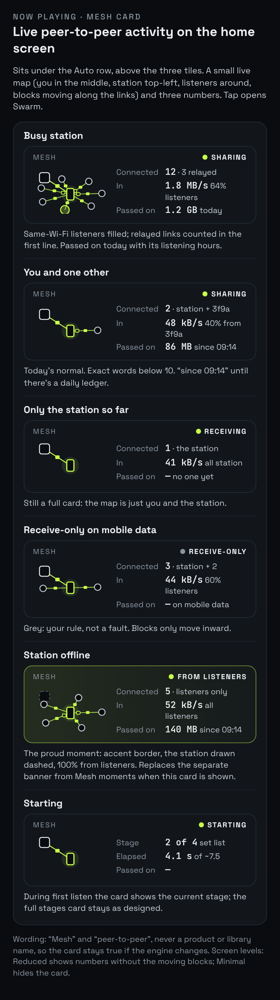

Busy station, you and one other, only the station so far, receive-only on mobile data, station offline (replaces the separate banner from Mesh moments), starting (stage 2 of 4, elapsed).

**Settings › Listening (user, 8 Nov: split):** `Use satellites` now reads `GPS time only · your position stays on this phone` and no longer affects being counted. New row under it: `Be counted as a listener` (default on) `Adds you to the listener estimate · off: you still listen and share`. Privacy mode (parked) would later turn both off.

## Co-listener countries

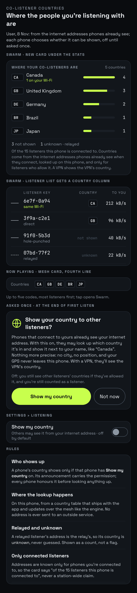

User, 8 Nov: show which countries co-listeners are in, **from IP addresses**, each phone opting in, **off until asked once**.

| Element | Shows |
|---|---|
| Swarm card `WHERE YOUR CO-LISTENERS ARE` | Under the stats: one row per country (ISO code chip, English name, bar, count), most first; a same-Wi-Fi note in accent; footer counts `3 not shown`, `1 unknown · relayed`; one line on where it comes from and that a VPN shows the VPN's country. Always "of the N listeners this phone is connected to". |
| Swarm listener list | New COUNTRY column: code chip, or `not shown` / `unknown` in muted mono. |
| Mesh card on Now playing | Fourth line `Countries` with up to five code chips. |
| Asked once | At the end of first listen: `Show your country to other listeners?` (what's shared: country from the address they already see; nothing more precise; VPN note; what Off means). `Show my country` / `Not now`. |
| Settings › Listening | `Show my country` (off by default) `Others may see it from your internet address · off by default`. |

| Rule | Detail |
|---|---|
| Consent | A phone's announcement carries its Show-my-country flag; others look it up only if set. |
| Lookup | On the phone, from a country table shipped with the app and updated over the mesh. No address goes to an outside service. |
| Relayed | The address is the relay's: `unknown`, never guessed; counted, not listed by country. |
| Scope | Only connected listeners; never a station-wide claim. |
| Few listeners | No minimum: countries show however few listeners are connected (user, 8 Nov). |

## Sync view · line mode

| Screen | States |
|---|---|
| 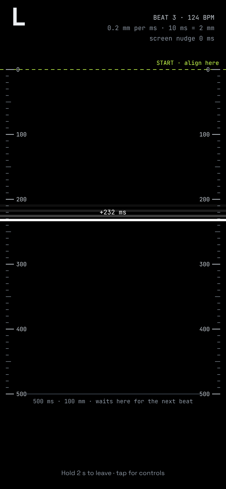 | 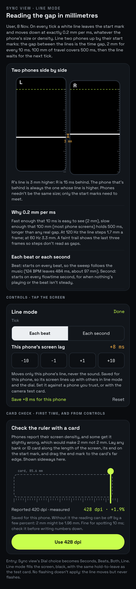 |

User, 8 Nov. Full screen, black. On each tick a 4 px white line leaves a dashed accent **start mark** and moves down at **0.2 mm per ms** (physical, from the screen's density; 10 ms = 2 mm) for 100 mm (500 ms), then waits at the end line for the next tick. Two phones lined up by their start marks show their time gap as a height gap; the phone behind has the higher line.

| Element | Shows |
|---|---|
| Top | Label (L/R/A/B as the test card), `BEAT 3 · 124 BPM`, `0.2 mm per ms · 10 ms = 2 mm`, `screen nudge 0 ms` |
| Start mark | Dashed accent across the screen, `START · align here` |
| Rulers | Both edges, every 10 ms (2 mm), longer at 50, labelled every 100 ms (0–500) |
| Line | 4 px white, `+232 ms` above it; a faint trail of the last 3 frames (25%, 12%, 6%) so frame steps (1.7 mm at 120 Hz, 3.3 mm at 60 Hz) don't read as gaps |
| End line | Grey at 100 mm, `500 ms · 100 mm · waits here for the next beat` |
| Bottom | `Hold 2 s to leave · tap for controls` |

| State | Shows |
|---|---|
| Controls (tap) | Tick: Each beat / Each second. **This phone's screen lag** −10 −1 +1 +10, value in amber when not 0; moves only this phone's line, never the sound; `Save +8 ms for this phone`, Reset. Saved per phone and applied to the dial too. |
| Card check | First time, and from controls: lay a bank or ID card (85.6 mm) along the screen from the start mark and drag the end mark to its far edge; `Reported 420 dpi · measured 428 dpi · +1.9%`; Use 428 dpi. Saved per phone. |
| No flashing | Doesn't apply: the line moves but never flashes. |

## Station upload page (desktop, SSH tunnel only)

| Running order | Publishing |
|---|---|
| 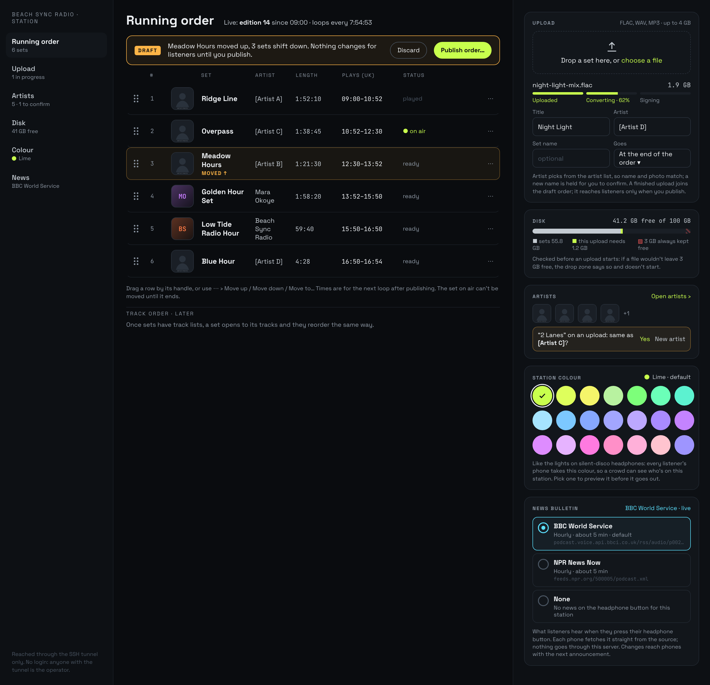 | 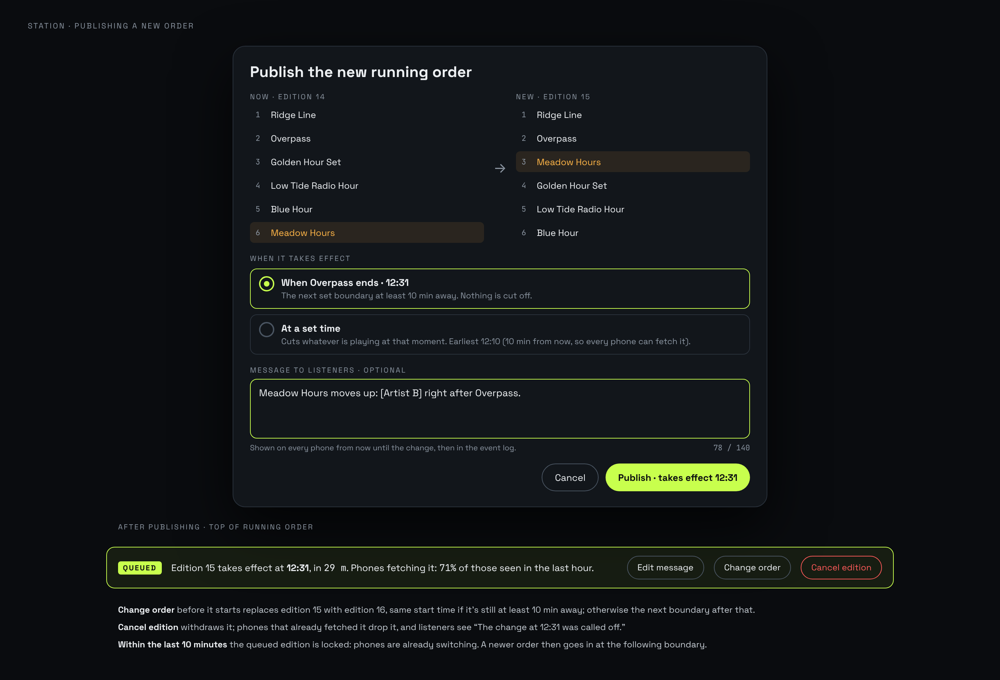 |

User, 8 Nov: redesign the page; reorder sets; announce to listeners. 1440 wide, dark, three columns.

| Area | Shows |
|---|---|
| Left rail | `BEACH SYNC RADIO · STATION`; Running order (6 sets), Upload (1 in progress), Artists (5 · 1 to confirm), Disk (41 GB free), **Colour** (a dot and the colour's name); footer: tunnel only, no login. |
| Running order | Title, `Live: edition 14 since 09:00 · loops every 7:54:53`. Table: drag handle, #, thumbnail, set, artist, length, plays (UK, for the next loop), status (`played` muted, `● on air` accent, `ready`), ⋯ (Move up / Move down / Move to…). The on-air set can't be moved. Moved rows: amber tint and `MOVED ↑`. |
| Draft bar | Amber, `DRAFT`: what changed and that nothing reaches listeners until published; Discard; **Publish order…** |
| Track order | `TRACK ORDER · LATER`: once sets have track lists, a set opens to its tracks and reorders the same way. |
| Upload | Drop zone (FLAC, WAV, MP3, up to 4 GB); file with three-step progress Uploaded → Converting % → Signing; Title, Artist (from the artist list; a new name held to confirm), Set name (optional), Goes (At the end of the order ▾). A finished upload joins the draft. |
| Disk | Bar: sets, this upload's need (accent), 3 GB kept free (hatched red); refused before starting if it wouldn't leave 3 GB. |
| News bulletin (user, 9 Nov) | `NEWS BULLETIN` card under Station colour, cyan: radio list **BBC World Service** (hourly · about 5 min · default; URL shown with the key masked), **NPR News Now** (`feeds.npr.org/500005/podcast.xml`), **None**. Top right: the live choice. Note: each phone fetches straight from the source; nothing through this server; changes reach phones with the next announcement. Rail gets **News · BBC World Service**. Full URLs: `comms/news-feeds.local.md` (gitignored). |
| Station colour | `STATION COLOUR` card under Artists: the current colour's dot and name, then the 21 swatches (7 × 3, 40 px, the current one ringed with a tick). Picking one opens the colour dialog (Station colour section). |
| Artists | Thumbnails, Open artists ›, confirm prompt (`"2 Lanes" on an upload: same as [Artist C]?` Yes / New artist). |

| Publishing | Shows |
|---|---|
| Dialog | Now (edition 14) → New (edition 15) side by side, moved set highlighted. **When it takes effect:** `When Overpass ends · 12:31` (default: next set boundary ≥ 10 min away, nothing cut off) or `At a set time` (cuts what's playing; earliest now + 10 min). **Message to listeners** (optional, 140 chars): shown on every phone until the change, then in the event log. `Publish · takes effect 12:31`. |
| Queued bar | Top of Running order: `QUEUED · Edition 15 takes effect at 12:31, in 29 m. Phones fetching it: 71% of those seen in the last hour.` Edit message, Change order, Cancel edition (red). |
| Rules | Change order before it starts → a new edition at the same time if still ≥ 10 min away, else the next boundary. Cancel withdraws it; phones drop it and say so. Last 10 min: locked. |

## Station colour

| Upload page | Phone |
|---|---|
| 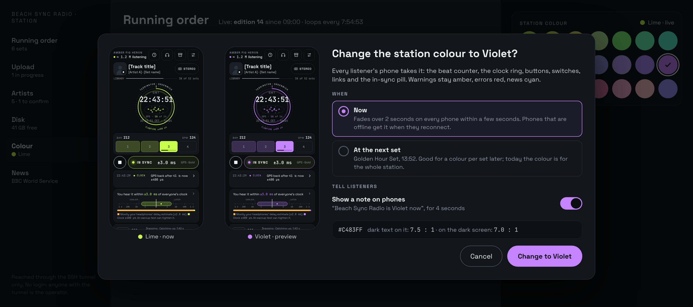 | 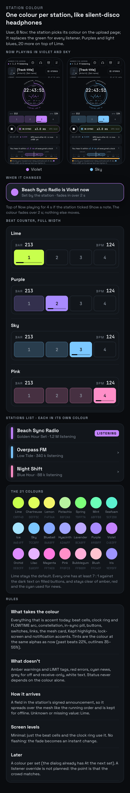 |

User, 8 Nov: a colour per station, like the lights on silent-disco headphones, set on the upload page. It **replaces the lime accent** on every listener's phone. 21 colours, all chosen to work with the dark design.

| Part | Rule |
|---|---|
| Palette | Lime `#C8FF4D` (default), Chartreuse `#DEFF5C`, Lemon `#F4F56A`, Pistachio `#B8F2A0`, Spring `#7DFF7A`, Mint `#6BFFB8`, Seafoam `#5CF2D0`, Ice `#A6E4FF`, Sky `#7CC8FF`, Bluebell `#86A8FF`, Hyacinth `#A2A6FF`, Lavender `#BCA8FF`, Purple `#A98BFF`, Violet `#C483FF`, Orchid `#DE8CFF`, Lilac `#E6B3FF`, Magenta `#FF7AE0`, Pink `#FF8FC8`, Bubblegum `#FFB0D9`, Blush `#FFC4CF`, Iris `#9E95FF`. Each is at least 7 : 1 against `#0A0C0F` (the dark text on filled buttons) and against the card colour. None is amber, red or the news cyan. |
| Dialog | Picking a swatch opens `Change the station colour to Violet?` with Now playing in the current colour and the new one side by side; **When**: Now (fades over 2 s on every phone; offline phones get it on reconnect) or At the next set; **Tell listeners**: `Beach Sync Radio is Violet now` for 4 s (on by default); the contrast figures; Cancel / Change to Violet (filled in the new colour). |
| What takes it | Everything accent today: beat cells, clock ring and FLOWTIME arc, constellation, in-sync pill, buttons, switches, links, mesh card, Kept highlights, lock-screen and notification accents. **Every tint is the station colour at an alpha** (past beats 22%, outlines 35–55%, glows 14–22%); today some boards hard-code `rgba(200,255,77,…)`, so make it one token. |
| What doesn't | Amber warnings and LIMIT, red errors, cyan news, grey off/receive-only, white text. Status never depends on the colour alone. |
| Phone | A toast at the top of Now playing when it changes (dot, `Beach Sync Radio is Violet now`, `Set by the station · fades in over 2 s`). Stations list: a bar of each station's colour by its name; the one you're on says `LISTENING` in its colour. |
| Delivery | A field in the station's signed announcement, spread over the mesh like the running order, kept for offline. Missing or unknown: Lime. No flashing on: change is instant. Minimal level: only the beat cells and clock ring use it. |
| Later | A colour per set (the At the next set option is the start of it). No listener override: the point is that the crowd matches. |

## Swarm · listener details

| Sheet | States |
|---|---|
| 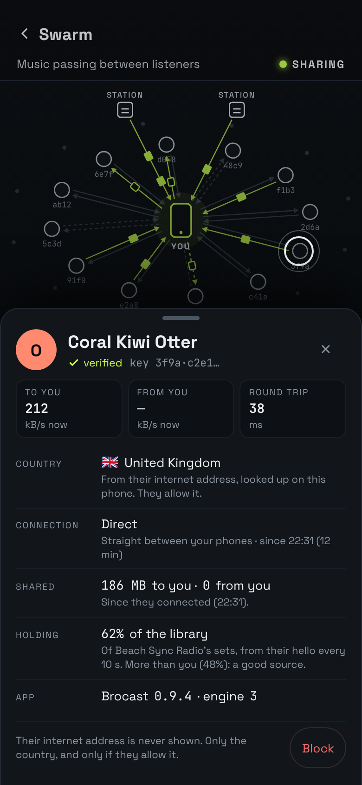 | 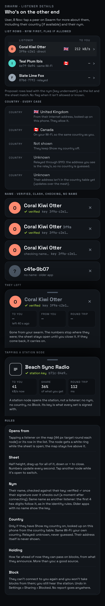 |

User, 8 Nov: tapping a peer on Swarm shows more about them, including their country (if available) and their nym.

| Part | Rule |
|---|---|
| Opens from | A listener node on the map (44 px target) or its row in the list. Node gets a white ring while open; map stays live. Tap another node to switch. Station nodes open a station sheet instead (name, station key ✓, to you, share, round trip; no nym, country or Block). |
| Sheet | Bottom sheet, half height, drag up for all, down or × to close; numbers update each second. |
| Header | Avatar (nym colour, animal initial), **nym** 19 px bold, `✓ verified` (accent) once their signature over the name checks out, else `checking name…`; `key 3f9a·c2e1…`. Same nym as another listener: 4 hex digits after it. No nym (older app): key as the title, `no name · older app`. |
| Numbers | Three tiles: To you (kB/s), From you (kB/s or —), Round trip (ms). |
| Rows | **Country**: flag emoji + name, `From their internet address, looked up on this phone. They allow it.`; same Wi-Fi: your country; `Not shown` (they keep Show my country off); `Unknown` when relayed (relay's address, never guessed) or not in the table. **Connection**: Direct / Hole-punched / Same Wi-Fi / Relayed via <key>, with since time. **Shared**: MB to you · from you, today. **Holding**: how far ahead they can pass on blocks. **App**: version and engine. |
| Footer | `Their internet address is never shown. Only the country, and only if they allow it.` and **Block** (red outline): they can't connect to you and you take nothing from them; you still hear the station; undo in Settings › Sharing › Blocked; no report sent. |
| They left | Header greyed, tiles `—` with `left 40 s ago`; sheet stays until closed; resumes if they return. |
| List rows (proposal) | Lead with avatar + nym, key and path underneath, flag if allowed, to-you rate, ›. |
| Data | Nym and its signature from their announcement; country from the bundled country table (only with their permission flag); link path, RTT, rates, holding from the engine. Never the IP address on screen. |

## News on the headphone button

| Now playing | Settings | States |
|---|---|---|
| 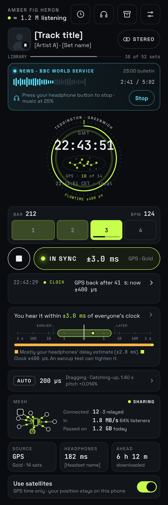 | 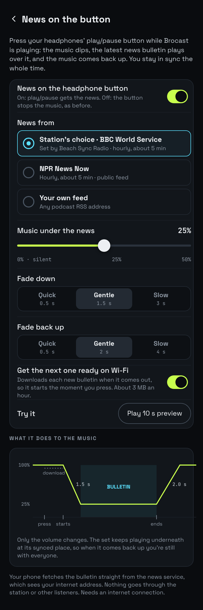 |  |

User, 8 Nov: press play/pause on the headphones while listening → music fades to 20–30%, the latest hourly news bulletin plays over it, music fades back up. Needs internet. **On by default**; music level and fade speed in Settings. Brocast is non-commercial and open source.

| Part | Rule |
|---|---|
| Button | Media-session play/pause **while music plays**: soft two-note chime at once, then fetch (or use the ready one), fade down, play. Press during the bulletin: stop it, fade up. Brocast stopped: the button starts the music as before. Setting off: play/pause stops/starts as before. Next/previous do nothing. On-screen Stop always stops the music. |
| Volume | Music under the news: slider 0–50 %, default **25 %** (≈ −12 dB). Fade down: Quick 0.5 s / **Gentle 1.5 s** / Slow 3 s. Fade back up: Quick 0.5 s / **Gentle 2 s** / Slow 4 s. Equal-power curve. Music fades only once the bulletin is ready to play. |
| Sync | Only the music's gain changes; the set keeps its synced place, beat counter and clock carry on. |
| Card on Now playing | Under the track row, above the clock. Cyan (news colour) gradient, `NEWS · BBC WORLD SERVICE`, `23:00 bulletin`; waveform fills as it plays, `2:41 / 5:02`; `Press your headphone button to stop · music at 25%`; **Stop**. States: Getting (spinner, MB, `music stays up until it starts`), Playing, Ending (`Music coming back up · 2 s`), then it slides away. |
| Can't | No internet: toast `No news without internet`, low tone, music unchanged. No answer in 10 s: `News isn't answering right now`. Newest older than 2 h 30 m: treated as not answering; otherwise plays with its age (`21:00 · 2 h old`). |
| Settings › Listening › News on the headphone button | Row `On · BBC World Service · music to 25%` → page: switch (on), **News from** (Station's choice · default / NPR News Now / Your own feed: any podcast RSS), Music under the news slider, Fade down, Fade back up, **Get the next one ready on Wi-Fi** (on: fetch each new bulletin when published, ~3 MB/hour), Play 10 s preview, fade diagram, privacy line. |
| Source | The station picks BBC World Service (default), NPR News Now or None on the upload page; the feed URL travels in the **station's signed announcement** (kept in server config, not in code or git). Listener's `News from`: Station's choice / NPR News Now / Your own feed. Station chose None: the row reads `This station has no news · pick one below`; the switch stays on and uses the listener's pick, else the button behaves as before. |
| Ads | Played as sent, never cut. |
| Privacy | `Your phone fetches the bulletin straight from the news service, which sees your internet address.` |

## Satellites · gesture hint

User, 8 Nov: on first opening of Satellites, or the 3rd opening without using gestures, show an effect that prompts two-finger navigation.

| Part | Rule |
|---|---|
| When | Opening 1, always. Opening 3, only if openings 1–2 had no pinch and no two-finger tilt. Never after. An opening counts once the screen has been up 2 s in 3D. Opened in Flat: waits for the first switch to 3D. |
| Effect (4 s, played twice) | Scene dims 35 %. 0–0.4 s: two finger marks fade in (white ring, soft fill). 0.4–1.6 s: they spread with dashed arrows and the view really zooms out ~15 %; pill `Pinch to zoom`. 1.6–2.2 s: they come together, lower. 2.2–3.4 s: they slide up together and the view really tilts +17°; pill `Slide up or down to tilt`. 3.4–4 s: marks fade; view eases back exactly to where it was. No accent colour. |
| After | Caption under the box: two-ring icon, `Two fingers: pinch to zoom, slide to tilt · or use − +`, until the first two-finger gesture or 20 s. The orbit tour starts when the hint ends. |
| Stops | Any touch on the box: marks fade in 150 ms, the user's gesture takes over from the view on screen (no snap). |
| Reduce motion | Still card over the dimmed box: two finger marks, `Pinch to zoom · slide two fingers to tilt`, Got it. Same when-rules. |
| Screen readers | No animation; the box label gains `Pinch with two fingers to zoom, slide two fingers up or down to tilt, or use the zoom buttons.` once, on opening 1. |

## New running order on the phone

| State | Shows |
|---|---|
| Until the change | In the latest-event row's place, cyan (news, not warning): `RUNNING ORDER CHANGES · 12:31 · in 29 m`, the operator's message in quotes, `After Overpass: Meadow Hours (was Golden Hour Set) · ready on this phone ✓`. Minutes, then seconds in the last minute. |
| Notification | Once, at publish (if notifications are on and the app used in the last week). |
| Buffer up next | New next set with `new order · was Golden Hour Set` in cyan. |
| The switch | All phones on the same flowtime second; toast `New running order: Meadow Hours is on now.` (6 s). |
| Event log | Published (with message) and switched lines. |
| Away | On reconnect: `The running order changed at 12:31 while you were away.` |
| Called off | Card grey for 1 min: `The change at 12:31 was called off.` |

## Badge states

| Badge | Mark and colour | When |
|---|---|---|
| IN SYNC ± | ● accent, glowing | GPS is in charge and the sync error is 5 ms or less (amber above) |
| HOLDING ± | ○ accent | The holdover clock is in charge. Turns amber by itself above 5 ms. |
| PRIVACY MODE ± | lock icon, neutral (`textSecondary`) | Satellites are off. Neutral at **any** error, with no fault words, no GPS banners and no prompts to turn satellites on. |
| INTERNET TIME ± | ▲ amber | Satellites are on but there's no GPS time yet |
| REJOINING | ▲ amber | A data gap longer than D, or a jump of more than 20 ms |
| SILENT · OVER LIMIT ± | ▲ amber, with offers | Over the event's limit. Offer what could help: **Sync from nearby phones** (**later**), and **Use satellites** if they're off. GPS is never required. |
| CLOCK CHECK FAILED | ✕ red (`danger`) | GPS and NTP differ by more than 50 ms |
| NOT IN SYNC | ✕ red | No stream while playing (there is always a time source) |
| STOPPED ± | ■ grey (`textMuted`), neutral outline | The listener has not pressed Play, or pressed Stop. Never red. The figure is the clock's own error and the source line reads `clock ready`. |
| DOWNLOADING n% | download arrow, neutral outline, with the time left | The set due now hasn't arrived; Play is disabled until it has |
| TIGHTENING chip | accent text | Under the badge, only when the tightening rule above holds |

## Stream gap · nudge control

| Element | Shows | Source | States and taps | Status |
|---|---|---|---|---|
| Held gap | The gap, large; why it exists (the event that moved flowtime); and flowtime's own error, labelled as separate | `NudgeControl.gapAt`, `EventLog` | | now |
| Auto / Manual | Segmented control | `NudgeControl.mode` | Auto by default | now |
| Period slider | Log scale from 1 s to 5 min. A marker shows the recommended period. The span below the rate limit is hatched. | `NudgeControl.periodS`, plus the recommended period | Manual only. Use a real slider with a value text for screen readers. | now |
| Time left, pitch change | Real time left, and the pitch change in % and cents | `secondsLeft`, `state.rate` | Updates while the gap closes | now |
| Preview | The gap falling to zero over the chosen period | Derived from the values above | | now |
| Go / Pause | Go starts closing the gap; it becomes Pause while closing | `NudgeControl` | | now |
| Jump now | Fixes the gap at once, with a short fade | `NudgeControl` | Secondary style | now |

## Event log

| Element | Shows | Source | States and taps | Status |
|---|---|---|---|---|
| Copy | The log as plain text, for support | `EventLog.recent(n)` | | now |
| Lane filter | All, Clock, Audio, Net, Output, Screen, each with its mark | `Lane` | Scrolls sideways; one chip selected at a time | now (Screen lane later) |
| Timeline scope | Five lanes of event marks over the sync-error trace, with a 5 ms line, for the last 15 min | `EventLog`, plus error history (**later**) | Tap a mark to select its row; pinch to zoom | later (marks now) |
| List | Time, lane tag, plain text; newest first; the selected row highlighted | `Event.utc`, `lane`, `text` | Text wraps; `--:--:--` with no time source | now |

Lane marks: clock ● accent, audio ■ #FFB547, net ▲ #5CE1FF, output ○ #B79CFF, screen ◆ #FF8FB1.

**Event wording** (the user's request, 3 Nov). Every event is one sentence in two parts: **what happened, with its size**, then a colon, then **what Brocast is doing about it** (or its result). Use the required terms, "This device" for the phone, the µs rule, and no internal names (no "underrun", "fit", "fetch", "NTP" in listener text; "internet time" instead). The same text shows in the latest-event row on Now playing, where it wraps.

| Lane | Example |
|---|---|
| Audio | `This device is rushing 18.2 ms: slowing-down playback over 60 s` |
| Audio | `This device is dragging 5.0 ms: catching-up playback over 20 s`, then `Caught up after 20 s: in step` |
| Audio | `Audio ran dry for 20 ms: played silence and stayed in step` |
| Clock | `GPS back after 41 s: timing tightened from ±11.4 ms to ±400 µs` |
| Clock | `GPS lost: holding time from the last fix, ±600 µs and growing` |
| Clock | `Time source changed from internet time to GPS: now ±400 µs` |
| Net | `Can't reach the station: connection timed out. Playing from downloads` |
| Net | `Station reachable again after 3 s: nothing was missed` |
| Output | `Output changed to Bluetooth "Earbuds": audio now sent 182 ms early` |
| Screen | `Screen dimmed to Reduced: phone warm, 39 °C. The music is unaffected` |

A repeated event within 10 s gets a count (`×3`) instead of new rows. The Copy action for support may add the internal detail (codes, field names) after each sentence.

## Time signals

| Element | Shows | Source | Status |
|---|---|---|---|
| Sources field | GPS, HOLD and the NTP nodes sized by error, with the one in charge lit | `FlowTime.gps/ntp`, `chosen` | partly (one NTP server today) |
| Use satellites | The same switch as Now playing, with `Position stays on this phone · Off = Privacy mode` | `GpsTime.active` | now |
| Sky plot and legend | Satellite positions, constellation, signal strength | Counts only today | later (counts now) |
| NTP servers | Host, stratum, reference, round trip, offset from GPS | `NtpClient` (one server) | partly |
| Safety check | GPS vs NTP, and its age; PASSED or FAILED | `NtpClient.minusGpsUs` | now |

### Tap a source

The user's request (5 Nov): tapping a node in SOURCES shows what it is. Each node, its line and its label make one 44 px target. The tapped node gets a white ring and a sheet rises: the name and its state (`in charge`, `standing by`, `in use`, `discarded`), a plain definition, then live details. Tap another node to switch; swipe down or × to close. The SOURCES caption reads `Node size = accuracy. Tap a node to see what it is.`

| Node | Definition | Details |
|---|---|---|
| Flowtime | The shared clock every phone plays to: UK time, Teddington · Greenwich, following the most accurate source | Source in charge, error, hand-overs this session |
| GPS | Time from navigation satellites via this phone's GPS chip; the best a phone can get | Satellites used of seen, Gold or Silver, last fix, error; link to Satellites |
| Hold | This phone's own clock carrying on from the last satellite fix; takes over when GPS drops, error grows with time and temperature | Error now, growth rate, last fix, when internet time would take over; link to Satellites |
| Internet time server (NTP) | A time server over the internet; S1 is one step from an atomic clock; NPL is the UK's National Physical Laboratory | Server, stratum, reference, round trip, difference from GPS, error, in use or discarded |

## Calibration

The user asked for calibration in Settings (2 Nov). It replaces the Headphone lag screen and keeps its file name (`headphone-lag`), so there is one home: the HEADPHONES tile, Settings › Listening › Calibration and the new-headphones prompt all open it. Accuracy figures on every Calibration screen are examples; nothing has been measured on phones yet, so the copy never promises a figure.

| Element | Shows | Source | Status |
|---|---|---|---|
| Route card | Output name and route (`Bluetooth · connected 26 min`), lag large (mono), ±, a source chip (`TABLE`, `EARCUP`, `HANDSHAKE` or `TYPED`) and when it was measured; for a handshake, the other phone's model | `Playout.track.routedDevice`, `Settings.lagMs`; the rest **later** | partly |
| Bluetooth note | Shown only on Bluetooth: its delay can change each time it connects, so a saved value may not hold | Route | now |
| Sources | One row each: Shared table, Earcup test, Two-phone test, Typed. Value, ±, and `IN USE` on the one in use; `not yet` where empty. | **later** | later |
| Which one is used | Typed, if set, overrides everything. Otherwise the most recent test (earcup or two-phone). Otherwise the table. Otherwise 0 ms ±40 (Not measured). | | later |
| Actions | `Earcup test · about 10 s` (primary), `Two-phone test`, and a `Type a value` link | | later |
| Mic note | The mic is on only during a test, and no audio leaves the phone | | |

**Applying a value:** a saved value takes effect when playback next starts, because lag is fixed for a run today. Tests stop playback, so there is no `Apply now` (Claude Code, 2 Nov).

**Sync error budget:** the Headphone lag bar uses the ± of the value in use (Typed counts as ±20 ms, Not measured as ±40 ms).

## Earcup test

The board shows the steps of one flow stacked; on the phone each is one screen.

| Step | Shows | Taps |
|---|---|---|
| 1 · Place the cup | A drawing of a cup held over the phone's mic; instructions; `Needs the mic for about 15 s. Nothing is recorded or sent. Playback stops during the test.` For a portable speaker: no cup, `put the phone right next to it, mic towards the speaker`. | Start. The system mic permission appears the first time. |
| 2 · Listening | Two stages, `Speaker clicks` then `Headphone clicks` (✓ done, ● now), a progress bar, clicks heard (`14 of 20`) and time left | Cancel |
| 3 · Result | See Earcup result | Save, Try again |
| Failures | ▲ `Too quiet`, ▲ `Too noisy`, ▲ `Readings disagree` (with the spread, `150–230 ms`), each with the fix in one line | Try again, Cancel. Nothing is saved. |

## Earcup result

Redesigned after a real run (Galaxy with ATH-M50xBT2) where `-19.7 ms ±4.0` and `-39.7 ms later than this phone's speaker` left the direction unclear. **Rule: no signs anywhere on this screen. Direction is always a word: later or earlier, early or late.**

| Element | Shows | Source |
|---|---|---|
| Eyebrow | Device's reported name · route (`[HEADSET NAME] · BLUETOOTH`); `SPEAKER` wording for a portable speaker | Output |
| Headline | `Your headphones play 182 ms later than the phone's speaker.` The number and direction word in accent, mono for the number | Measured gap: headphones minus speaker (mic) |
| Confidence | Words plus mark plus the ±: ● `GOOD` (± under 5 ms), ▲ `UNSTEADY` (5–15 ms), ✕ `TRY AGAIN` (over 15 ms) | ± = speaker's uncertainty + 1.0 + both legs' scatter. Thresholds are starting values. |
| Timeline | Two clicks on a time line, speaker then headphones, with an arrow from the speaker click to the headphone click and `182 ms later` under it. Gaps under 120 ms are drawn wider so the labels fit (schematic). | |
| What gets saved | Three labelled rows: `Phone speaker's own delay` (value, and where it comes from: `from the shared table for [Phone model]`, or `measured`), `Headphones vs speaker` (`182.0 ms later`, measured just now by the mic), `Saved delay for these headphones` (accent, bold). Then: `Brocast will send audio 202 ms early, so it reaches your ears on time.` | Saved = speaker's own + gap. A positive saved value reads `early`, a negative one `late`. |
| Mic check | Renamed from "ms from the output stamp": `How long after each headphone click left the phone the mic heard it. Good: one sharp peak. Several peaks or a flat line: try again.` Status `✓ ONE CLEAR PEAK`, or ▲ `SEVERAL PEAKS` / `NO CLEAR PEAK`. Plus the match plot. It is the mic's own measurement, not a cross-check. | Correlation by delay |
| Share this result | Switch, on by default, `Shared as [nym], with the device's own name and model` | Publishes to Hyperdrive under the listener key and nym (**later**, needs the Pears spike) |
| Applies | `Applies when playback next starts.` | |
| Buttons | Save (primary) and Try again. With ✕ TRY AGAIN: Try again only. | |

## Earcup result states

| State | Shows | Buttons |
|---|---|---|
| Unusual direction | ▲ amber `UNUSUAL RESULT`; `Your headphones played 39.7 ms earlier than the phone's speaker.`; the timeline reversed in amber; `Bluetooth headphones are almost always later. Press the cup flat over the mic and try again.`; then what saving would do (`Brocast would send audio 19.7 ms late`) | Try again (primary), Save anyway |
| Confidence | The three levels and what each allows: Good, Save is primary; Unsteady, Save allowed and Try again suggested; Try again, not saved or shared | |
| Share this result | Off by choice (`The result stays on this phone`); locked off in Privacy mode (parked); hidden for a failed test, because only passed tests publish | |
| Portable speaker | `Your speaker plays 145 ms later than the phone's own speaker.` Step 1 without a cup | |

## Two-phone test

| Step | Shows | Taps |
|---|---|---|
| 1 · Choose roles | `Measure this phone` (gets the result) or `Help another` (shows a code); place the phones side by side; both need GPS or internet time good enough | Start |
| 2 · Taking turns | A row of click dots (solid: this phone, outline: the other) filling in, and time left | Cancel |
| 3 · Swap the code | The helper shows a 6-digit code (`472 916`) and a QR code of it; the measuring phone has six boxes | Type the code or `Scan instead` |
| 4 · Result | Lag and ±, `HANDSHAKE` chip, the route, the other phone's model, and when it applies | Save, Try again |
| Failures | ✕ `Time not good enough` (with this phone's figure, and turn satellites on or wait), ▲ `Clicks not heard`, ▲ `Code doesn't match` | Try again |

The ±1 ms time threshold in the copy is a placeholder until the code side sets it. Whether Privacy mode allows this test is parked with the rest of Privacy mode.

## Calibration prompts

| Item | Shows | Taps |
|---|---|---|
| New headphones | A bottom sheet when an output with no saved value starts playing: name, that it may sound up to ±40 ms off, and the 10 s fix. Once per output. | Test now, Not now |
| Not in the shared table | `0 ms ±40 ms`, ▲ amber `NOT MEASURED`, and a line asking for a test | |
| Saved during playback | See Applying a value above | Apply now, Later |
| Typed (advanced) | A number field in ms, `± unknown`, and that it overrides every measured value until cleared | |
| Settings row | See Settings › LISTENING · Calibration | Opens Calibration |

## Test bench (prototype)

This screen restyles today's test controls with the same data.

- **Locked while running:** Mode, Time source, Stream channel, Server, Tick pitch and Headphone lag.
- **Never locked:** Use satellites.
- **Status grid:**
  - OUTPUT: `Playout`
  - PLAYOUT: `Renderer`
  - GAP: `NudgeControl`
  - NTP: `NtpClient`
  - GPS: `GpsTime`, `FlowTime.gps.slope`
  - LOG: `Session.name`

## Notification, lock screen and quick settings

 

Android draws all three from one `MediaSession` and its media notification. The app supplies only the content below. Use Android's media style and don't design a custom notification layout. (The foreground service that keeps playback alive with the screen off is code; see `feedback.md`.)

| Slot | Content | Source | Updates |
|---|---|---|---|
| Title (`METADATA_KEY_TITLE`) | The track, for example `Sundown Tide`; falls back as in the Track names rule | Stream track metadata | At heard time (Track names rule) |
| Subtitle (`METADATA_KEY_ARTIST`) | `artist · set`, for example `Mara Okoye · Golden Hour Set` | Stream track metadata | At heard time |
| Album (`METADATA_KEY_ALBUM`) | Badge words, the ± figure and the source, for example `In sync ±3.2 ms · GPS`. Car and watch displays show it. | The badge state and sync error | Only under the redraw rule below |
| Artwork (`METADATA_KEY_ART`) | A 512 × 512 state tile, rendered by the app (`screens/notification-art.png`) | Badge state, ± figure | Only under the redraw rule |
| Playback state | `STATE_PLAYING` or `STATE_STOPPED`; no duration, so no seek bar | `Playout.state` | On change |
| Main button | Stop or Play. Play rejoins the live point at D; there's no pause. | | |
| Custom action 1 | **Use satellites:** icon on (Material Symbols `satellite_alt`) or off (the same icon crossed through). Label `Satellites on` or `Satellites off (Privacy mode)`. | `GpsTime.active` | On change |
| Content intent | Opens Now playing | | |

**Redraw rule:** update the album text and artwork only when the badge state changes, or when the ± figure moves a step (1, 2, 5, 10, 20 ms) and holds it for 10 s. Never update every second.

**Artwork tile:** a dark ground (`bg`), the tick ring, the meridian tick and the `TEDDINGTON · GREENWICH` bezel, a static arc, the state mark, the state word, and the ± figure. Use the state's colour from `tokens.color.status`. Keep everything that matters in the middle 60%, because Android crops it and lays a scrim over it. Privacy mode is neutral at any error. Not in sync has no arc.

**Lock screen:** no nudges to turn location on. If location isn't allowed yet, the satellites button opens the app after unlock to ask, and stays off until then.

## Test bench states

| Part | Design |
|---|---|
| Run chip | STOPPED: an outline in `faint`, text in `textSecondary`, a square mark. RUNNING: an accent outline, a glowing dot, and elapsed `mm:ss`. |
| Start / Stop | START RUN: filled accent with dark text and a ▶. STOP RUN: a `text` outline with a ■. Both 52 high and full width. |
| Settings | 100% opacity and editable while stopped; 55% and locked while running. Use satellites is never locked. |
| Satellites switch, off | Track: a 1.5 px outline in `faint`; thumb: 18 px in `muted`, on the left. On: an accent track with a 22 px thumb in `bg`, on the right. The same on every screen. |
| Rate nudge row | A 48 px row: the mode chip (AUTO outlined in `faint`; MANUAL outlined and lettered in accent), the gap value in 14 px mono, two 11 px lines (`Dragging · Catching-up, 1.40 s` over `pitch +0.014%`; Manual and paused: `gap · paused` over `period 20 s`), then a chevron. No gap: the value reads `in step` in `muted`, with no small lines. Opens Nudge control. The same row appears on Now playing. |
| STREAM row | Stream mode only, after PLAYOUT: newest segment, seconds buffered, fetch errors, server−flowtime |
| Error lines | One extra line under the row, in `warn` with ▲, cut to one line. The **whole status row** (label, value and error line) is the tap target, at least 44 px tall. It opens the event log at that row's lane: OUTPUT opens AUDIO, NTP and STREAM open NET. The row always shows the latest error text. If the text changes while the error continues, the log adds a line (`still failing: …`). |
| Tightening | One line under the source detail in the flowtime card: `TIGHTENING` in accent, then `±from → ±to` in `muted` mono. Only under the tightening rule. |

---

## Screen levels

Each phone moves between levels automatically, based on heat, missed frames, underruns and battery. The level is always named on screen (`SCREEN · MINIMAL` in the screen's corner), along with the reason. Levels never change the audio.

| Level | Every screen |
|---|---|
| Full | As drawn |
| Reduced | No glows, no sweep, and no animated hand-overs. Clocks update to 0.1 s at 4 Hz, traces at 1 Hz. |
| Minimal | Pure black, text only, one update a second, no animation. The clock shows whole seconds, the badge is words, the event log is plain text, and the satellites switch stays. See `screens/now-playing-minimal.png`. |
| Off | Screen off. The notification and lock-screen player carry the state (see Notification, lock screen and quick settings). |

The light show follows its own rules. A screen level can reduce flashes but can never start the show without the listener's opt-in. The three-flashes limit and the "no flashing" setting always apply.
