# UI spec (hand-off 13)

Field names come from Claude Code's "Fields that exist today" table in `feedback.md`, as of 1 Nov 2026. If one has been renamed since, use the new name.

**Status of each element:**

- **now:** the data exists today.
- **later:** the element needs data or a feature that's listed in `feedback.md` under "Not in the app yet". Lay out its space and show `—`.

**Rules for every screen:**

- **Units:** below 1 ms, show µs (ns below 1 µs); from 1 ms up, ms (the user's decision, 2 Nov): `±400 µs`, never `±0.4 ms`. Every duration uses adaptive units, like `Session.fmtNs` (ns, µs, ms), at three significant figures. Every live number is in JetBrains Mono.
- **Sync error** (the user agreed, 2 Nov): the figure shown to the listener is √(flowtime error² + output lag uncertainty²) plus the absolute held gap. Flowtime error is `errAt(boot)`; output lag uncertainty is the ± of the saved value in use (Calibration); the held gap is `NudgeControl.gapAt`, added in full because it is known, not uncertain. Example: √(0.4² + 2.8²) + 0.20 = ±3.0 ms. Every term must be the same kind of range (95% is the aim) before the budget may say `95%`; until confirmed it says no percentage. Every ± in a badge is this number.
- **Flowtime error and stream gap are separate.** Never add them together on screen, except in the badge figure above.
- **Times** come from flowtime, never the system clock. Show `--:--:--` before there is a time source. The main clock and the event log show UK time (`Europe/London`, GMT or BST), branded **Teddington · Greenwich**. Local time sits beneath, using only the phone's time-zone setting, never its clock. Hide it when its offset equals UK time's. CSV logs stay in UTC ns.
- **Tightening** (see Badge states) appears once the error estimate has improved by at least 20% for 10 s, and stays for 10 s (Claude Code's `tighteningFromNs` behaviour, 2 Nov). Smaller changes update quietly, with no animation. When both figures share a unit, the unit is written once (`±11.4 → ±8.20 ms`); otherwise both are written out (`±11.4 ms → ±400 µs`).
- **Track names** (title, artist, set or show) come from the stream, stamped by sample number. They switch when the new track's first sample reaches the ear (start + n / 48 kHz + D), never when the name arrives, so the name changes with the music. With no track name, show the set or show; with neither, show the station or event, with `Live` as the second line. Show the progress line only when the stream gives the track's start and length.
- **Parked** until the Pears proof of concept is validated (user, 2 Nov): **Privacy mode** (satellites off) also turns off sharing, and any social feature added later (the user's decision, 2 Nov). It never changes the listener's saved choices: they come back when satellites go back on. Nothing in Privacy mode asks the listener to turn satellites on.
- **Required terms** (the user's decision, 2 Nov): **Rushing** (heard ahead of flowtime), **Dragging** (heard behind flowtime), **Catching-up** (nudging faster to catch up) and **Slowing-down** (nudging slower). Always these words, never "gap closes" or "sound is behind flowtime". The pitch figure shows a minus when Slowing-down.
- **Now playing updates once a second** (the user's decision, 2 Nov). Nothing on it needs a faster refresh.
- **Screen levels** (Full, Reduced, Minimal, Off): see the last section. Every screen follows them.
- **Accessibility:** use words and a mark, never colour alone. Every tappable item is at least 44 × 44. Respect reduced motion: no sweep and no glow pulse. Screen-reader labels match the visible words.

---

## Now playing

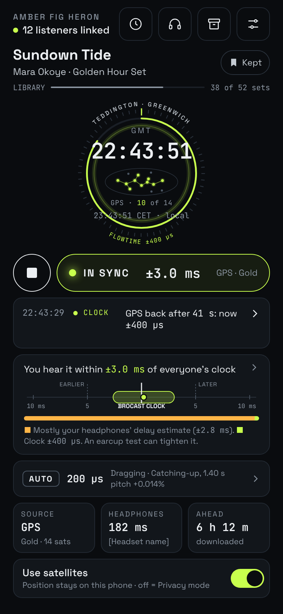

| Element | Shows | Source | States and taps | Status |
|---|---|---|---|---|
| Header | Left (user's request, 3 Nov: the station name and `Live · D 60 s` added nothing): your colour-fruit-animal name as the eyebrow (`AMBER FIG HERON`), then `● 12 listeners linked` (accent dot; the count of connected listeners). Inside an event, the event name replaces your name. The whole block opens Swarm. D stays on the Test bench only. Right: icon buttons (44 × 44) for Time signals, Calibration, Archive and Settings | Listener key nym; swarm connection count | Taps open Swarm | later |
| Now playing | Track title (20 px, bold, one line), `artist · set` (13 px, `textSecondary`), a **Kept** marker, then the **library line**: `LIBRARY`, a thin bar and `38 of 52 sets` | File record and cue list; library download state | Kept is locked on for the beta (the user's decision): a bookmark and `Kept`, not a button, no tap. The library line shows download progress of the whole library; when it is complete it reads `52 sets · all here`. | partly |
| Brocast clock | A dial. Along the top of the bezel, curved: `TEDDINGTON · GREENWICH`, with an accent meridian tick at 12 o'clock between the two names. Inside: the zone (GMT or BST), HH:MM:SS large, the **time-source pictogram**, then local time. Updates once a second; no sub-second dial and no ns digits. | Flowtime | See the Times rule | now |
| Seconds sweep | The outer accent arc fills once per flowtime **minute**, like a second hand | Seconds of the current minute | Steps once a second at Reduced level | now |
| Time-source pictogram | **Satellites:** a mini constellation: the sky squashed into a small ellipse, one dot per satellite in view, lit in accent for each one in use, the ones in use joined by faint lines (the same shortest-path pattern as the Satellites screen), no labels; then `GPS · 10 of 14`. Tapping it opens Satellites. **Hold:** an accent hourglass beside the same sky gone dark, `HOLDING · 41 s`. **NTP:** a cell tower with radio waves, `NTP · stratum 1` (Privacy mode shows this one). **None yet:** a grey tower with a red ✕, `NO TIME YET`. | `FlowTime.chosen`, `GpsTime.used`, `seen`, `lastBoot`, `NtpClient.stratum`; per-satellite positions **later** (until then, place dots evenly) | Updates once a second | partly |
| Precision ring | A glow whose width shows the sync error on the budget's log scale; its figure is on the bottom bezel | Sync error | | now |
| Play control and sync badge | A 52 px round button left of the badge: **Stop** (a white square, outlined) while playing; **Play** (an accent-filled circle with a dark triangle) when stopped; dashed and disabled while the set due now is downloading. The badge shows words, the ± figure and the source. | See Badge states | Play starts in sync at once. Tapping the badge opens the error budget detail. | now |
| Latest event | Time, lane mark and name, and the event text, **directly under the badge**. The text wraps onto as many lines as it needs, with no ellipsis, and the row grows (the user's decision, 2 Nov). | `EventLog.latest()` | Tapping opens the Event log. A banner elsewhere links to its own event. | now |
| Sync card (replaces the error budget, user's request 3 Nov) | **Headline:** `You hear it within ±3.0 ms of everyone's clock` (the badge figure, accent). **Window:** a linear line from 10 ms earlier to 10 ms later around the Brocast clock (a white tick, `BROCAST CLOCK`); an accent band shows where this phone's sound most likely is (centred on the held gap, here 200 µs later, half-width √(clock² + delay estimate²)); a dot marks the centre; dashed lines at ±5 ms mark a typical event limit, labelled `EARLIER` and `LATER`. The scale widens to ±50 ms when the band would not fit. **What makes up the ±:** one bar split by each part's share of the total (squared), output delay estimate in amber, clock in accent, then one sentence naming the largest part and what would tighten it (`Mostly your headphones' delay estimate (±2.8 ms). Clock ±400 µs. An earcup test can tighten it.`). The output word follows the output in use. | Badge figure; `errAt`; Calibration ±; `NudgeControl.gapAt` | The whole card opens Time signals for the detail. | partly |
| Gap row | The rate nudge row: mode chip, the gap value, then two small lines (`Dragging · Catching-up, 1.40 s` and `pitch +0.014%`; Rushing with Slowing-down shows `pitch −0.014%`) | `NudgeControl.gapAt`, `mode`, `secondsLeft`, `state.rate` | Opens Nudge control. The 60 s gap trace has left this screen to make room for the track; history belongs on Nudge control, **later**. | now |
| Tiles | SOURCE, the output tile (`HEADPHONES`, `SPEAKER`, `PORTABLE SPEAKER` or `CAR AUDIO` by the output in use, with lag and the device's reported name), AHEAD (how much is downloaded ahead, in hours and minutes) | `FlowTime.chosen`, `GpsTime`, `Settings.lagMs`, download state (**later**) | SOURCE opens Time signals; HEADPHONES opens Calibration; AHEAD opens Buffer | partly |
| Use satellites | A full-width row with a switch, never locked, one tap from the main screen. Shows `Position stays on this phone · off = Privacy mode`. | `GpsTime.active` | Off: the badge becomes Privacy mode. On: asks for location permission if needed; if refused, it returns to off. | now |

## Settings

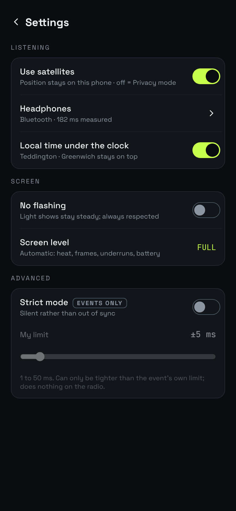

| Element | Shows | Source | States and taps | Status |
|---|---|---|---|---|
| LISTENING · Use satellites | The same switch as Now playing | `GpsTime.active` | Never locked | now |
| LISTENING · Calibration | `Calibration`, then route · lag ± · source (`Bluetooth · 182 ms ±2.8 · Earcup`), as a link | `Playout.track.routedDevice`, `Settings.lagMs`; ± and source **later** | Opens Calibration | partly |
| LISTENING · Local time under the clock | A switch, on by default | A new setting | Off hides the local line on every clock | now |
| SCREEN · No flashing | A switch, off by default | Not built (light show) | Always respected; screen levels never override it | later |
| SCREEN · Screen level | The current automatic level | Not built | Read-only | later |
| ARCHIVE · Keep | Segmented: Off, Kept only, Everything. Off by default (opt-in). | A new setting | See Archive rules | later |
| ARCHIVE · Size limit | Stepped slider: 1, 2, 5, 10, 20, 50 GB; 5 GB by default | A new setting | Disabled in Kept only and Off | later |
| ARCHIVE · Storage bar | Rolling (accent) out of the limit, then Kept (`text`) as extra | Archive store | | later |
| ARCHIVE · Open archive | A link | | Opens Archive | later |
| DELIVERY · Download ahead on mobile data | A switch, on by default, with `About 72 MB an hour of listening` | A new setting | Off: downloads only on Wi-Fi | later |
| DELIVERY · Share with other listeners | A switch, with `Only on Wi-Fi, while charging and not playing` | A new setting | On by default, set by the first-use prompt (see First use). Locked off in Privacy mode (parked). Status line: see Sharing states. | later |
| DELIVERY · Only during global parties | A switch, off by default, with `Share only while a scheduled Brocast party is on` | A new setting; party windows from the signed schedule | Adds party times to the conditions. Dimmed while sharing is off or locked. Not on the first-use sheet. | later |
| DELIVERY · Sharing allowance | A storage figure, separate from the archive | A new setting | | later |
| ADVANCED · Strict mode | A switch tagged `EVENTS ONLY`, off by default, plus a `My limit` slider (1–50 ms, default 5), dimmed while off | Not built (needs events) | Applies only inside an event, and can only tighten the event's own limit. On the radio it does nothing, and the caption says so. | later |

## Archive

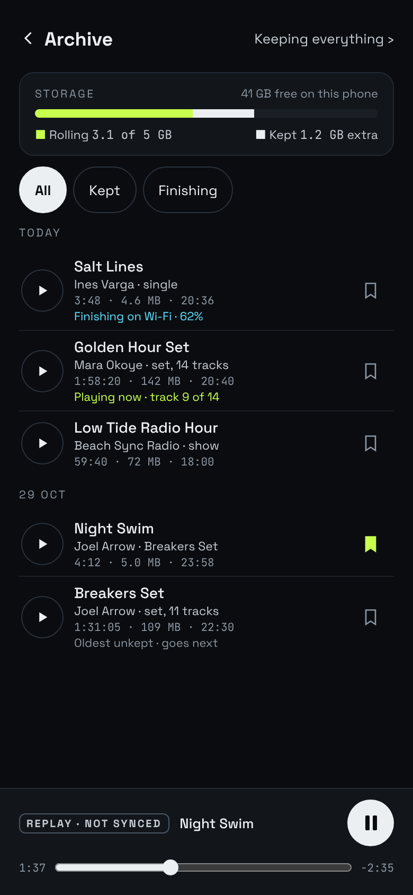

**Archive rules (the user's decisions, 2 Nov):**

- **Keep modes:** Off (the default), Kept only, or Everything.
  - **Everything:** every file heard goes into a rolling archive capped by the size limit. When it's full, the oldest file that isn't kept is removed first (FIFO).
  - **Keep overrides the limit (confirmed):** a kept file is never removed and doesn't count toward the limit. It's shown as `extra`.
  - **Kept only:** only files the listener keeps are stored, and the limit is disabled.
- **Files, not cues:** what's kept is the published file, a single track or a whole set. Inside a set, Keep keeps the set.
- **Joined part-way:** the rest of the file downloads on Wi-Fi, shown as `Finishing on Wi-Fi · n%`.
- **Low phone storage:** when the phone's free space runs low, the rolling archive stops adding files and says so. Kept files are never touched.

| Element | Shows | Source | States and taps | Status |
|---|---|---|---|---|
| Header link | The current mode, for example `Keeping everything ›` | Archive setting | Opens Settings › Archive | later |
| Storage card | The two-part bar; phone free space | Archive store | | later |
| Filter | All, Kept, Finishing | | One at a time | later |
| Day groups | TODAY, then dates | File play times | Newest first | later |
| Rows | Replay button, title, `artist · single`, `set, n tracks` or `show`, then `length · size · time heard` in mono; the keep mark on the right | Signed file record | Status line: `Playing now · track 9 of 14` (accent), `Finishing on Wi-Fi · 62%` (#5CE1FF), or `Oldest unkept · goes next` (muted) | later |
| Replay bar | `REPLAY · NOT SYNCED` chip, title, play and pause, a scrubber with elapsed and remaining time | Offline playback | Replay can pause and seek, because it's off the timeline. Starting a replay stops live playback, and a later `Back to live` rejoins at the live point. Replay never touches flowtime. | later |

## First use: sharing

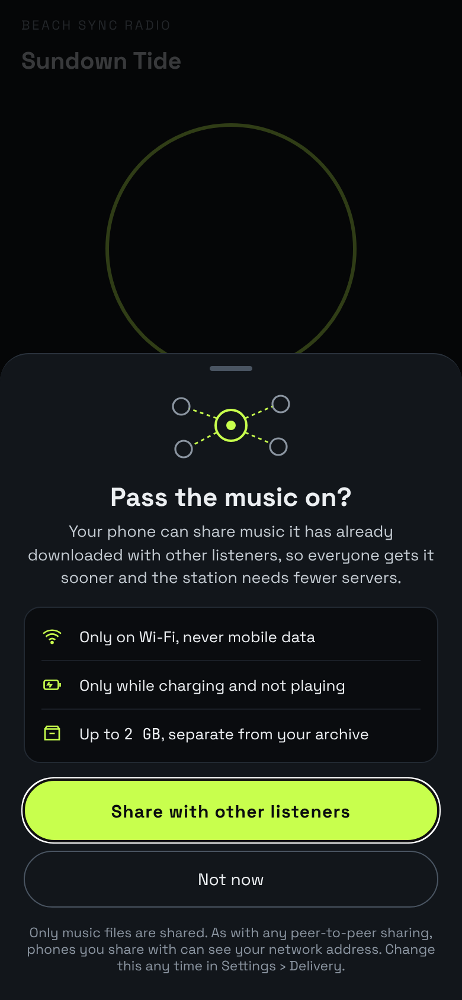

The user's decision (2 Nov): on first use the listener chooses whether to share downloads with other listeners, and the default is on.

| Element | Shows | States and taps |
|---|---|---|
| Sheet | A bottom sheet over Now playing, shown once at first launch, before any sharing starts | It must be answered: no swipe-away, and back doesn't dismiss it. Sharing never starts before the answer. **In Privacy mode it waits (parked):** sharing stays off, and the sheet appears the first time Use satellites is turned on. |
| Picture | Your phone in accent, linked to four outlined phones | Decorative, hidden from screen readers |
| Title and body | `Pass the music on?`, then why it helps: everyone gets the music sooner, and the station needs fewer servers | |
| Conditions | Three rows: only on Wi-Fi; only while charging and not playing; up to the sharing allowance, separate from the archive | The allowance shows the real current value. The party-only option lives in Settings, not here. |
| Share with other listeners | Primary button: the default, with initial focus | Turns sharing on |
| Not now | Secondary button | Leaves sharing off. Nothing asks again; Settings › Delivery can turn it on. |
| Footnote | Only music files are shared; as with any peer-to-peer sharing, peers can see the phone's network address; how to change it later | This line must stay, because it's the honest part of the default |

Peers are found across the network, not by distance, so the wording says **other listeners**, never "nearby".

## Sharing states

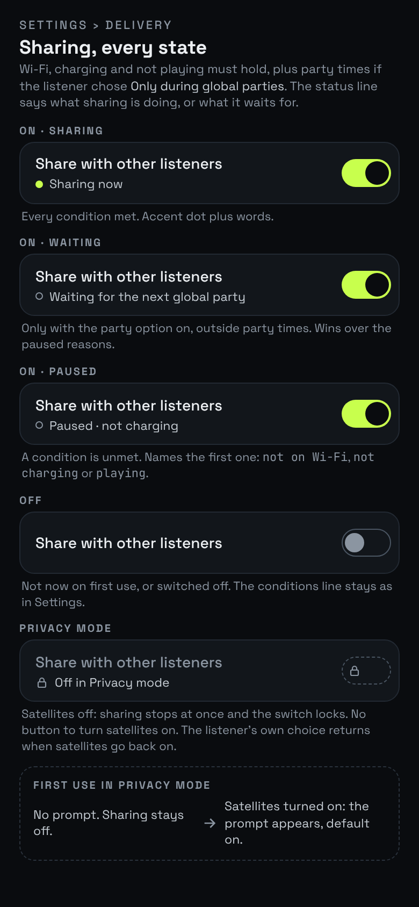

The sharing row in Settings › Delivery. Sharing runs only on Wi-Fi, while charging and not playing. If the listener turns on **Only during global parties** (the user's decision, 2 Nov: a listener option, off by default), it also waits for a scheduled party.

| State | Switch | Status line (under the title) | When |
|---|---|---|---|
| On · sharing | on | ● accent dot, `Sharing now` | Every condition holds |
| On · waiting | on | ○ outline dot, `Waiting for the next global party` | Only with the party option on, outside party times. Checked first, so it wins over the paused reasons. |
| On · paused | on | ○ outline dot, `Paused · ` plus the first unmet condition, in this order: `not on Wi-Fi`, `not charging`, `playing` | A condition isn't met |
| Off | off | none; the conditions line stays | `Not now` on first use, or switched off |
| Privacy mode (**parked**) | locked: dashed outline with a lock, `aria-disabled` | lock icon, `Off in Privacy mode`; the title in `textSecondary` | Satellites off. Sharing stops at once. No button to turn satellites on. The saved choice returns when satellites go back on. |

In Settings the conditions line is the subtitle; in these states the status line takes its place while the switch is on or locked. Party windows need to come from the signed schedule (**later**); only the party option uses them.

## Buffer

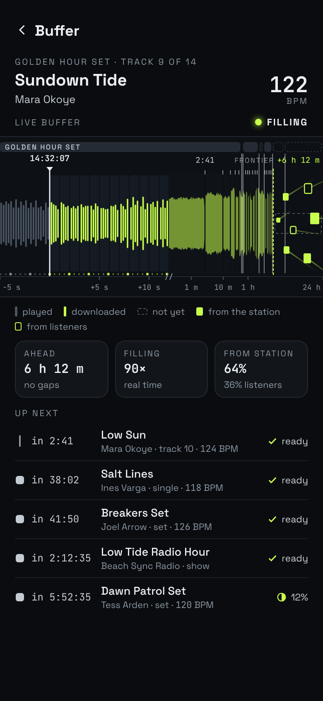

Opens from the AHEAD tile on Now playing. It shows the music around the playhead, everything downloaded ahead of it, the 1 s blocks arriving at the frontier, and where tracks and sets change.

**One time axis** for this screen and every Buffer state, in a frame 390 wide (scale to the screen):

| Zone | Time | x | Scale |
|---|---|---|---|
| Played | −5 s to now | 0–60 | 12 px a second |
| Near | now to +12 s | 60–204 | 12 px a second, so each 1 s block is one 12 px tile |
| Downloaded | +12 s to the frontier | 204–330 | log |
| Not yet | the frontier to +24 h | 330–390 | log |

Whenever the frontier is more than 12 s ahead it sits at x 330, so arriving blocks always have room to land. When it is within 12 s, the near zone shows it directly, and 204–390 becomes one log span to +24 h, all not yet. An axis break (`//`) marks where seconds turn to log. Axis labels: `−5 s`, `+5 s`, `+10 s`, then `1 m`, `10 m`, `1 h`, `6 h` where they fall short of the frontier, and `24 h` at the end.

| Element | Shows | Source | Status |
|---|---|---|---|
| Track header | Set and track number, title, artist; BPM large on the right (mono) | File record and cue list; BPM **later** | partly |
| Status chip | One of the Buffer states, words plus mark | Download state | later |
| Set band | One pill per scheduled file (set, single or show), alternating two greys, named when 80 px or wider; dashed past the frontier | Signed schedule | later |
| Playhead | A thin `text` line with a small marker, and flowtime above it in UK time (no local line here) | Flowtime | now |
| Played | Four bars a second in `textMuted`, with no tile seams: played blocks are consumed | Waveform summary | later |
| Near, downloaded | One tile per 1 s block, four accent bars each | Block store, waveform summary | later |
| Downloaded, far | A loudness band in accent at 55% | Waveform summary | later |
| Beat dots | One dot a beat under the near waveform, larger on the first beat of the bar | Beat grid | later |
| Track and file lines | A track is a cut through the band plus a tick above it, drawn only 2 px or more from the last one. A new file is a full-height line at 50%. | Cue list, schedule | later |
| Next track | Its countdown above its line (`2:41`) | Cue list | later |
| Frontier | A dashed accent line, and `FRONTIER +6 h 12 m` top right | The first missing block on the timeline | later |
| Not yet | A dashed rail out to +24 h | Schedule | later |
| Blocks in flight | Tiles flying in from the right edge and shrinking onto the frontier, each with a fading trail. Solid: from the station (seed servers). Outline: from listeners. | Block arrivals, with source | later |
| Legend | played, downloaded, not yet, from the station, from listeners | | |
| Tiles | AHEAD (time to the frontier, then `no gaps` or `N gaps`), FILLING (arrival rate as a multiple of real time; `—` when steady), FROM STATION (share of this session's blocks, the rest from listeners; opens Swarm) | Download state | later |
| Up next | The next track in this set, then each scheduled file: countdown (`in m:ss` or `in h:mm:ss`), title, artist · kind · BPM, and `✓ ready` or `◐` with the percent downloaded. A short tick marks a track inside the current set; a filled square marks a new file. | Schedule, cue lists, block store | later |

**Motion:**

- **Full level:** redraw on every display frame (Choreographer), placed by flowtime at the frame's presentation time, the same as the clock. The music travels right to left into the playhead; the far zone drifts more slowly because it is log.
- **Blocks in flight:** one tile per batch of arrivals, never one per block, with at most about eight on screen. Each flies for about 400 ms, easing out as it lands. More arrivals mean more tiles, up to the cap.
- **Reduced level, or reduced motion:** step at 4 Hz, which moves exactly one bar per step. Tiles fade in at the frontier instead of flying.
- **Minimal:** text only, once a second: the status, AHEAD and Up next.
- **Cost:** draw from the waveform summary; never decode audio for the picture, and never touch the audio thread (lean timing path).

**Needs from code:**

1. **Waveform summary** per file: for example one peak every 250 ms, one byte each, about 14 KB an hour. The packager would make it at ingest and carry it in the signed file record, so the far zone works long before the audio is decoded.
2. **BPM per track**, and a beat grid if possible, from the packager. This ties in with the open light-track question about beat detection. Until then, hide BPM and the beat dots.
3. **Download state:** the frontier (the first missing block on the timeline), holes ahead of it, the arrival rate, and each block's source (station or listener).

## Buffer states

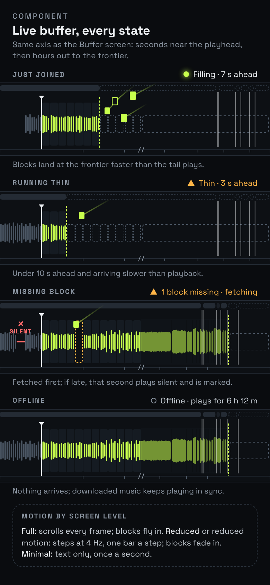

| State | Chip | When | In the strip |
|---|---|---|---|
| Filling | ● accent, `Filling · 7 s ahead` (the time ahead) | Arriving faster than real time | Blocks flying in |
| Full | ● accent, `Full · 24 h ahead` | The frontier has reached the end of the published schedule | About one block a second, as the station publishes |
| Thin | ▲ amber, `Thin · 3 s ahead` | Under 10 s ahead and arriving slower than playback | Few or no blocks in flight |
| Missing block | ▲ amber, `1 block missing · fetching` | A hole ahead of the frontier. It is fetched first. | A dashed amber tile. If it reaches the playhead, that second plays silent and the count carries on (playout step 6); the played zone then shows a flat red line marked `✕ SILENT`. |
| Offline | ○ `textSecondary`, `Offline · plays for 6 h 12 m` | No station or listeners reachable | Nothing in flight; the downloaded music plays on in sync |

When several apply, show the most urgent: Thin, then Missing block, then Offline, then Filling, then Full. The 10 s threshold is a starting value for the tests.

## Swarm

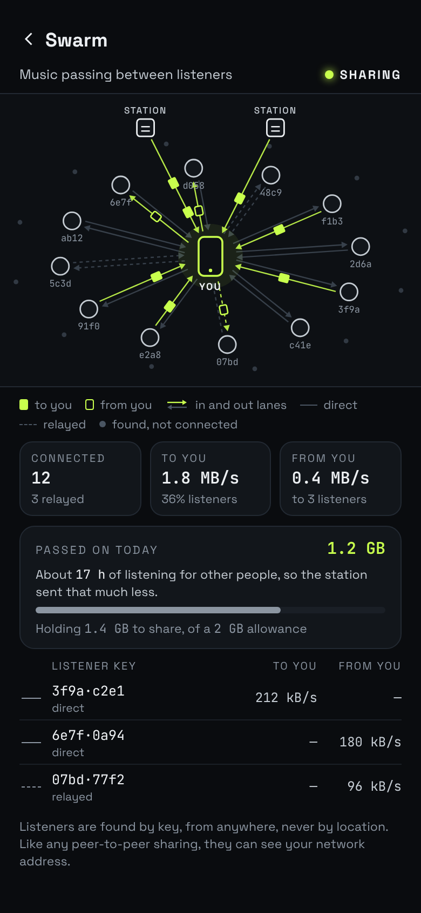

The user wants this to be a showcase for peer delivery (2 Nov), so the swarm gets its own screen. No Pears name or logo until the user confirms. Opens from the FROM STATION tile on Buffer.

| Element | Shows | Source | Status |
|---|---|---|---|
| Status chip | The same state as the sharing row in Settings › Delivery (see Swarm states) | Sharing state | later |
| Network | You at the centre (accent phone with a soft halo, `YOU`). Station seed servers as squares on top (`STATION`). Connected listeners on an ellipse, each labelled with the first 4 hex digits of its public key. Each listener link is two parallel lanes, each a single-headed arrow pointing the opposite way: the inner lane (to you) ends in a head at your phone, the outer lane (from you) ends in a head at the listener. A lane is accent while blocks move on it, grey when idle. Station links have only the to-you lane, because phones never upload to the station. Solid lanes: direct. Dashed: relayed. Grey dots on an outer ring: found but not connected. Never placed by location. | Swarm connections, peer keys, connection type | later |
| Blocks moving | Tiles ride their lane in the direction of the arrow, fading in at the start and out at the head, with a short trail behind. Solid: to you. Outline: from you. About 1.8 s per trip. The board animates this with SVG animation (no script). | Block transfers by peer | later |
| Tiles | CONNECTED (count, then how many relayed), TO YOU (rate, share from listeners), FROM YOU (rate, how many listeners) | Swarm stats | later |
| Passed on today | Bytes sent today, as listening time for others (at 72 MB an hour), and the held-to-share amount against the sharing allowance | Swarm stats, allowance setting | later |
| Listener list | The busiest few peers: key (8 hex digits), direct or relayed, rate to you, rate from you | Swarm connections | later |
| Footnote | Listeners are found by key, from anywhere, never by location, and can see your network address | | |

**Motion:** the same rules as Buffer. Full level: tiles move every frame, one tile per batch, at most about ten on screen. Reduced or reduced motion: 4 Hz steps, tiles fade instead of moving. Minimal: text only (chip, tiles, Passed on today). Nodes never move, so the picture is calm.

**Needs from code:** per-peer connection (key, direct or relayed, bytes each way), the station seed connections, a count of found-but-not-connected peers, and bytes sent today.

## Swarm states

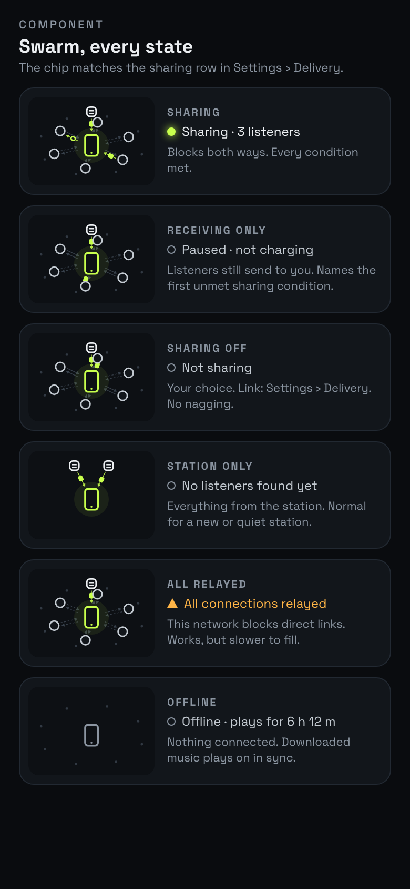

| State | Chip | When |
|---|---|---|
| Sharing | ● accent, `Sharing · 3 listeners` | Every sharing condition holds and someone is receiving |
| Receiving only | ○ `Paused · ` plus the first unmet condition | Sharing is on but paused (Sharing states); listeners still send to you |
| Sharing off | ○ `Not sharing` | The listener switched it off. Links to Settings › Delivery; no prompts. |
| Station only | ○ `No listeners found yet` | No peers connected |
| All relayed | ▲ amber, `All connections relayed` | Every peer connection goes through a relay: it works but fills more slowly |
| Offline | ○ `Offline · plays for 6 h 12 m` | Nothing connected; the phone dims to grey |

## Satellites

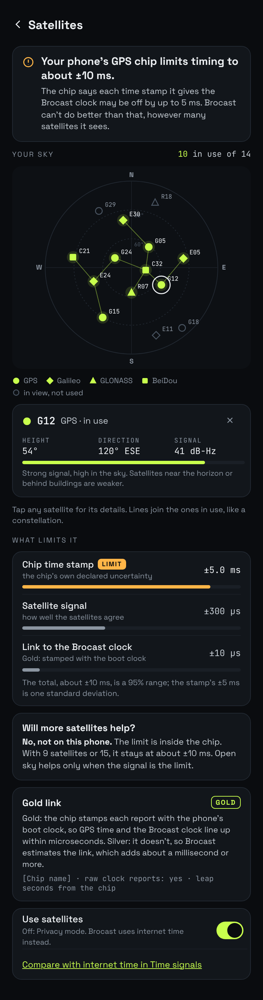

**A new detail screen**, not an extension of Time signals: Time signals compares sources (GPS against internet time); Satellites explains this phone's own GPS chip and sky. It opens from Settings › Listening (a `Satellites` row under Use satellites), from the clock-face pictogram, and from Time signals. It replaces the later Sky plot.

| Element | Shows | Source | Status |
|---|---|---|---|
| Verdict | One plain sentence naming the largest limit and its size (`Your phone's GPS chip limits timing to about ±10 ms.`), then the reason in words. A neutral info mark, not a fault: amber outline for a hardware limit, accent tick when the signal is the limit. | Largest of the What limits it rows | now |
| Your sky | Sky view: horizon circle, 30° and 60° rings, N E S W. One mark per satellite in view, shaped by system (GPS circle, Galileo diamond, GLONASS triangle, BeiDou square), filled accent when in use, outlined grey when not, each labelled (`G12`, `E05`, `R07`, `C21`). The satellites in use are joined into a **constellation**: faint accent lines along the shortest tree that links them. `10 in use of 14` top right. | Per-satellite azimuth, elevation, system, used-in-fix | later |
| Tap a satellite | A 44 px target round each mark. The tapped one gets a white ring, and a card below shows label, system, in use or not, height (elevation), direction (azimuth and compass word), signal (dB-Hz) with a bar, and one line in words. Close with ×. | Per-satellite C/N0 | later |
| What limits it | Three rows, each with figure and bar, the largest tagged `LIMIT` in amber: **Chip time stamp** (the chip's declared uncertainty, `erUnc`), **Satellite signal** (how well the satellites agree), **Link to the Brocast clock** (Gold or Silver). A note says which figures are 95% ranges and which one standard deviation. | `erUnc`, `biasUnc`, `gold`, the fit | now |
| Will more satellites help? | A direct answer: `No, not on this phone` when the chip or the link is the limit; `Yes` with open-sky advice when the signal is. | Which row is largest | now |
| Gold or Silver | A `GOLD` or `SILVER` chip and plain words for both. Then the chip name, whether it gives raw clock reports, and where leap seconds came from. | `gnssHardwareModelName`, `gold`, leap-second source | now |
| Use satellites | The same switch as everywhere, never locked, with `Off: Privacy mode. Brocast uses internet time instead.` and a link to Time signals | `GpsTime.active` | now |

## Satellites states

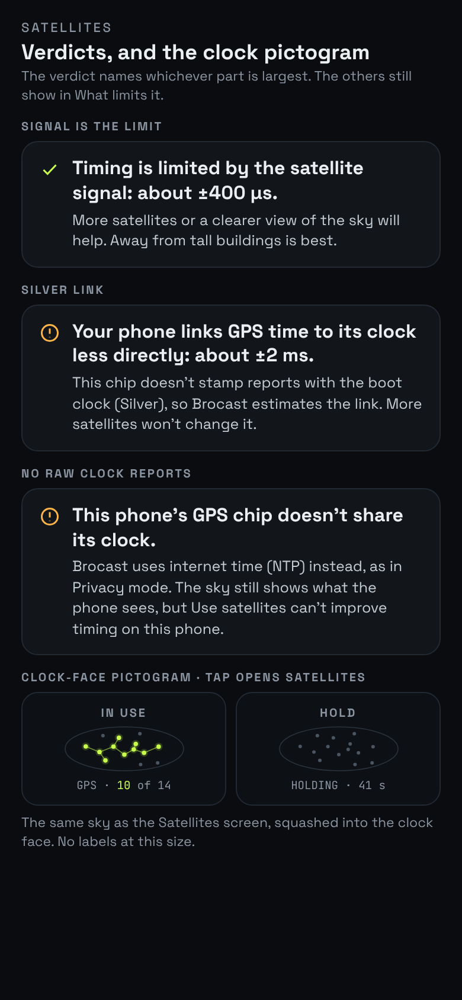

| State | Verdict |
|---|---|
| Chip is the limit | See Satellites (the Moto G32 case: ±10 ms with 9 to 15 satellites) |
| Signal is the limit | `Timing is limited by the satellite signal: about ±400 µs.` More satellites or a clearer sky will help |
| Silver link | `Your phone links GPS time to its clock less directly: about ±2 ms.` More satellites won't change it |
| No raw clock reports | `This phone's GPS chip doesn't share its clock.` Brocast uses internet time instead; the sky still shows, but Use satellites can't improve timing on this phone |

## Badge states

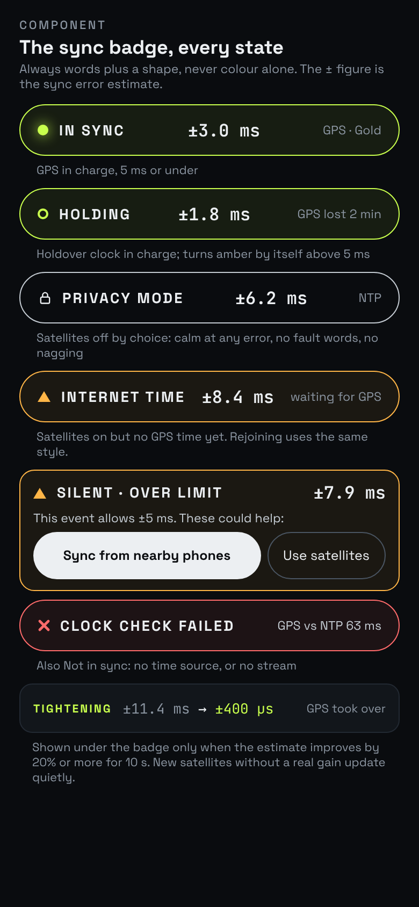

| Badge | Mark and colour | When |
|---|---|---|
| IN SYNC ± | ● accent, glowing | GPS is in charge and the sync error is 5 ms or less (amber above) |
| HOLDING ± | ○ accent | The holdover clock is in charge. Turns amber by itself above 5 ms. |
| PRIVACY MODE ± | lock icon, neutral (`textSecondary`) | Satellites are off. Neutral at **any** error, with no fault words, no GPS banners and no prompts to turn satellites on. |
| INTERNET TIME ± | ▲ amber | Satellites are on but there's no GPS time yet |
| REJOINING | ▲ amber | A data gap longer than D, or a jump of more than 20 ms |
| SILENT · OVER LIMIT ± | ▲ amber, with offers | Over the event's limit. Offer what could help: **Sync from nearby phones** (**later**), and **Use satellites** if they're off. GPS is never required. |
| CLOCK CHECK FAILED | ✕ red (`danger`) | GPS and NTP differ by more than 50 ms |
| NOT IN SYNC | ✕ red | No time source, or no stream, while playing |
| STOPPED ± | ■ grey (`textMuted`), neutral outline | The listener has not pressed Play, or pressed Stop. Never red. The figure is the clock's own error and the source line reads `clock ready`. |
| DOWNLOADING n% | download arrow, neutral outline, with the time left | The set due now hasn't arrived; Play is disabled until it has |
| TIGHTENING chip | accent text | Under the badge, only when the tightening rule above holds |

## Stream gap · nudge control

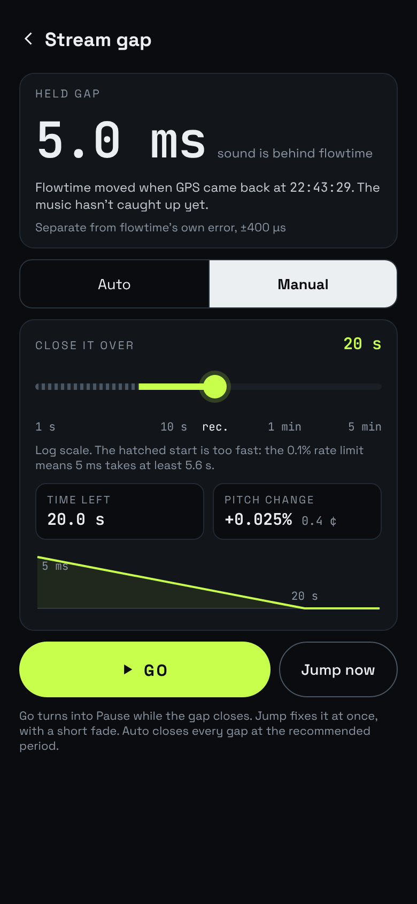

| Element | Shows | Source | States and taps | Status |
|---|---|---|---|---|
| Held gap | The gap, large; why it exists (the event that moved flowtime); and flowtime's own error, labelled as separate | `NudgeControl.gapAt`, `EventLog` | | now |
| Auto / Manual | Segmented control | `NudgeControl.mode` | Auto by default | now |
| Period slider | Log scale from 1 s to 5 min. A marker shows the recommended period. The span below the rate limit is hatched. | `NudgeControl.periodS`, plus the recommended period | Manual only. Use a real slider with a value text for screen readers. | now |
| Time left, pitch change | Real time left, and the pitch change in % and cents | `secondsLeft`, `state.rate` | Updates while the gap closes | now |
| Preview | The gap falling to zero over the chosen period | Derived from the values above | | now |
| Go / Pause | Go starts closing the gap; it becomes Pause while closing | `NudgeControl` | | now |
| Jump now | Fixes the gap at once, with a short fade | `NudgeControl` | Secondary style | now |

## Event log

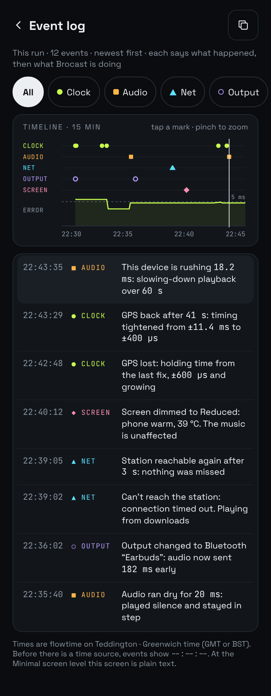

| Element | Shows | Source | States and taps | Status |
|---|---|---|---|---|
| Copy | The log as plain text, for support | `EventLog.recent(n)` | | now |
| Lane filter | All, Clock, Audio, Net, Output, Screen, each with its mark | `Lane` | Scrolls sideways; one chip selected at a time | now (Screen lane later) |
| Timeline scope | Five lanes of event marks over the sync-error trace, with a 5 ms line, for the last 15 min | `EventLog`, plus error history (**later**) | Tap a mark to select its row; pinch to zoom | later (marks now) |
| List | Time, lane tag, plain text; newest first; the selected row highlighted | `Event.utc`, `lane`, `text` | Text wraps; `--:--:--` with no time source | now |

Lane marks: clock ● accent, audio ■ #FFB547, net ▲ #5CE1FF, output ○ #B79CFF, screen ◆ #FF8FB1.

**Event wording** (the user's request, 3 Nov). Every event is one sentence in two parts: **what happened, with its size**, then a colon, then **what Brocast is doing about it** (or its result). Use the required terms, "This device" for the phone, the µs rule, and no internal names (no "underrun", "fit", "fetch", "NTP" in listener text; "internet time" instead). The same text shows in the latest-event row on Now playing, where it wraps.

| Lane | Example |
|---|---|
| Audio | `This device is rushing 18.2 ms: slowing-down playback over 60 s` |
| Audio | `This device is dragging 5.0 ms: catching-up playback over 20 s`, then `Caught up after 20 s: in step` |
| Audio | `Audio ran dry for 20 ms: played silence and stayed in step` |
| Clock | `GPS back after 41 s: timing tightened from ±11.4 ms to ±400 µs` |
| Clock | `GPS lost: holding time from the last fix, ±600 µs and growing` |
| Clock | `Time source changed from internet time to GPS: now ±400 µs` |
| Net | `Can't reach the station: connection timed out. Playing from downloads` |
| Net | `Station reachable again after 3 s: nothing was missed` |
| Output | `Output changed to Bluetooth "Earbuds": audio now sent 182 ms early` |
| Screen | `Screen dimmed to Reduced: phone warm, 39 °C. The music is unaffected` |

A repeated event within 10 s gets a count (`×3`) instead of new rows. The Copy action for support may add the internal detail (codes, field names) after each sentence.

## Time signals

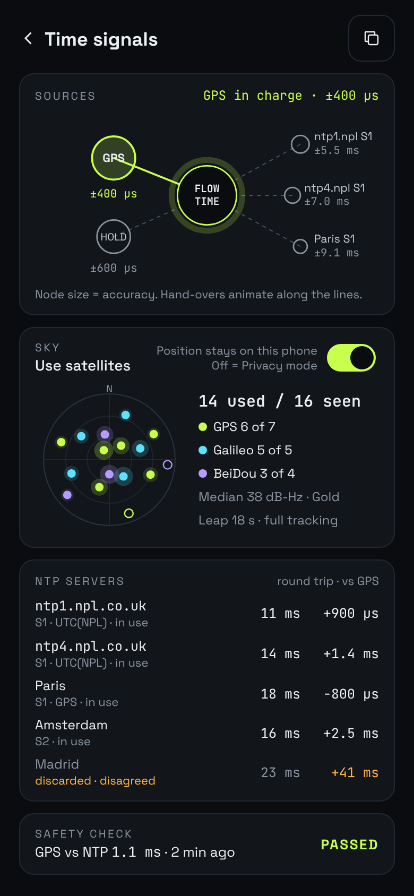

| Element | Shows | Source | Status |
|---|---|---|---|
| Sources field | GPS, HOLD and the NTP nodes sized by error, with the one in charge lit | `FlowTime.gps/ntp`, `chosen` | partly (one NTP server today) |
| Use satellites | The same switch as Now playing, with `Position stays on this phone · Off = Privacy mode` | `GpsTime.active` | now |
| Sky plot and legend | Satellite positions, constellation, signal strength | Counts only today | later (counts now) |
| NTP servers | Host, stratum, reference, round trip, offset from GPS | `NtpClient` (one server) | partly |
| Safety check | GPS vs NTP, and its age; PASSED or FAILED | `NtpClient.minusGpsUs` | now |

## Calibration

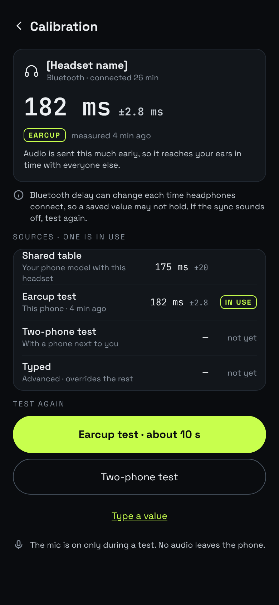

The user asked for calibration in Settings (2 Nov). It replaces the Headphone lag screen and keeps its file name (`headphone-lag`), so there is one home: the HEADPHONES tile, Settings › Listening › Calibration and the new-headphones prompt all open it. Accuracy figures on every Calibration screen are examples; nothing has been measured on phones yet, so the copy never promises a figure.

| Element | Shows | Source | Status |
|---|---|---|---|
| Route card | Output name and route (`Bluetooth · connected 26 min`), lag large (mono), ±, a source chip (`TABLE`, `EARCUP`, `HANDSHAKE` or `TYPED`) and when it was measured; for a handshake, the other phone's model | `Playout.track.routedDevice`, `Settings.lagMs`; the rest **later** | partly |
| Bluetooth note | Shown only on Bluetooth: its delay can change each time it connects, so a saved value may not hold | Route | now |
| Sources | One row each: Shared table, Earcup test, Two-phone test, Typed. Value, ±, and `IN USE` on the one in use; `not yet` where empty. | **later** | later |
| Which one is used | Typed, if set, overrides everything. Otherwise the most recent test (earcup or two-phone). Otherwise the table. Otherwise 0 ms ±40 (Not measured). | | later |
| Actions | `Earcup test · about 10 s` (primary), `Two-phone test`, and a `Type a value` link | | later |
| Mic note | The mic is on only during a test, and no audio leaves the phone | | |

**Applying a value:** a saved value takes effect when playback next starts, because lag is fixed for a run today. Tests stop playback, so there is no `Apply now` (Claude Code, 2 Nov).

**Sync error budget:** the Headphone lag bar uses the ± of the value in use (Typed counts as ±20 ms, Not measured as ±40 ms).

## Earcup test

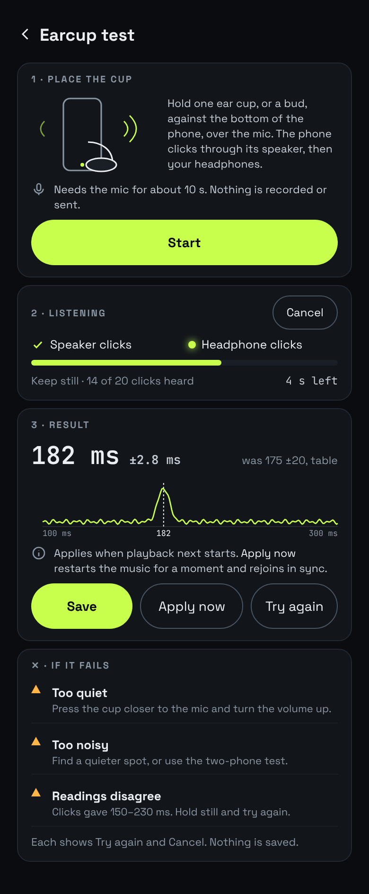

The board shows the steps of one flow stacked; on the phone each is one screen.

| Step | Shows | Taps |
|---|---|---|
| 1 · Place the cup | A drawing of a cup held over the phone's mic; instructions; `Needs the mic for about 15 s. Nothing is recorded or sent. Playback stops during the test.` For a portable speaker: no cup, `put the phone right next to it, mic towards the speaker`. | Start. The system mic permission appears the first time. |
| 2 · Listening | Two stages, `Speaker clicks` then `Headphone clicks` (✓ done, ● now), a progress bar, clicks heard (`14 of 20`) and time left | Cancel |
| 3 · Result | See Earcup result | Save, Try again |
| Failures | ▲ `Too quiet`, ▲ `Too noisy`, ▲ `Readings disagree` (with the spread, `150–230 ms`), each with the fix in one line | Try again, Cancel. Nothing is saved. |

## Earcup result

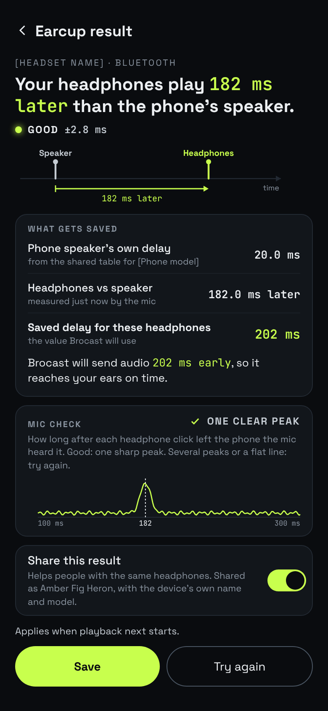

Redesigned after a real run (Galaxy with ATH-M50xBT2) where `-19.7 ms ±4.0` and `-39.7 ms later than this phone's speaker` left the direction unclear. **Rule: no signs anywhere on this screen. Direction is always a word: later or earlier, early or late.**

| Element | Shows | Source |
|---|---|---|
| Eyebrow | Device's reported name · route (`[HEADSET NAME] · BLUETOOTH`); `SPEAKER` wording for a portable speaker | Output |
| Headline | `Your headphones play 182 ms later than the phone's speaker.` The number and direction word in accent, mono for the number | Measured gap: headphones minus speaker (mic) |
| Confidence | Words plus mark plus the ±: ● `GOOD` (± under 5 ms), ▲ `UNSTEADY` (5–15 ms), ✕ `TRY AGAIN` (over 15 ms) | ± = speaker's uncertainty + 1.0 + both legs' scatter. Thresholds are starting values. |
| Timeline | Two clicks on a time line, speaker then headphones, with an arrow from the speaker click to the headphone click and `182 ms later` under it. Gaps under 120 ms are drawn wider so the labels fit (schematic). | |
| What gets saved | Three labelled rows: `Phone speaker's own delay` (value, and where it comes from: `from the shared table for [Phone model]`, or `measured`), `Headphones vs speaker` (`182.0 ms later`, measured just now by the mic), `Saved delay for these headphones` (accent, bold). Then: `Brocast will send audio 202 ms early, so it reaches your ears on time.` | Saved = speaker's own + gap. A positive saved value reads `early`, a negative one `late`. |
| Mic check | Renamed from "ms from the output stamp": `How long after each headphone click left the phone the mic heard it. Good: one sharp peak. Several peaks or a flat line: try again.` Status `✓ ONE CLEAR PEAK`, or ▲ `SEVERAL PEAKS` / `NO CLEAR PEAK`. Plus the match plot. It is the mic's own measurement, not a cross-check. | Correlation by delay |
| Share this result | Switch, on by default, `Shared as [nym], with the device's own name and model` | Publishes to Hyperdrive under the listener key and nym (**later**, needs the Pears spike) |
| Applies | `Applies when playback next starts.` | |
| Buttons | Save (primary) and Try again. With ✕ TRY AGAIN: Try again only. | |

## Earcup result states

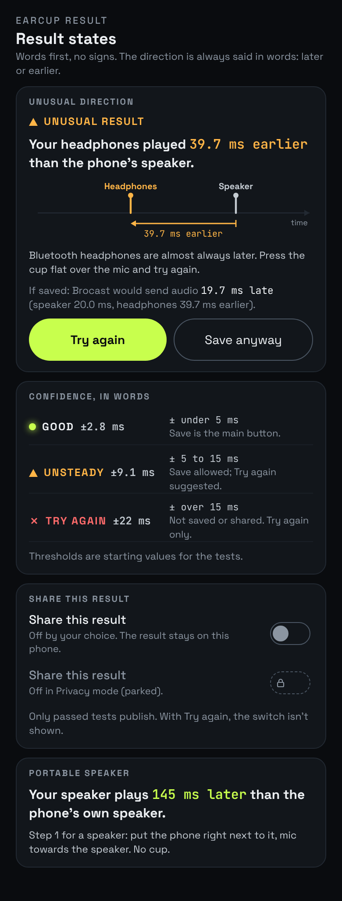

| State | Shows | Buttons |
|---|---|---|
| Unusual direction | ▲ amber `UNUSUAL RESULT`; `Your headphones played 39.7 ms earlier than the phone's speaker.`; the timeline reversed in amber; `Bluetooth headphones are almost always later. Press the cup flat over the mic and try again.`; then what saving would do (`Brocast would send audio 19.7 ms late`) | Try again (primary), Save anyway |
| Confidence | The three levels and what each allows: Good, Save is primary; Unsteady, Save allowed and Try again suggested; Try again, not saved or shared | |
| Share this result | Off by choice (`The result stays on this phone`); locked off in Privacy mode (parked); hidden for a failed test, because only passed tests publish | |
| Portable speaker | `Your speaker plays 145 ms later than the phone's own speaker.` Step 1 without a cup | |

## Two-phone test

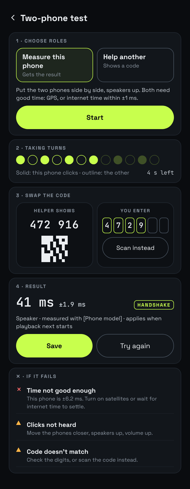

| Step | Shows | Taps |
|---|---|---|
| 1 · Choose roles | `Measure this phone` (gets the result) or `Help another` (shows a code); place the phones side by side; both need GPS or internet time good enough | Start |
| 2 · Taking turns | A row of click dots (solid: this phone, outline: the other) filling in, and time left | Cancel |
| 3 · Swap the code | The helper shows a 6-digit code (`472 916`) and a QR code of it; the measuring phone has six boxes | Type the code or `Scan instead` |
| 4 · Result | Lag and ±, `HANDSHAKE` chip, the route, the other phone's model, and when it applies | Save, Try again |
| Failures | ✕ `Time not good enough` (with this phone's figure, and turn satellites on or wait), ▲ `Clicks not heard`, ▲ `Code doesn't match` | Try again |

The ±1 ms time threshold in the copy is a placeholder until the code side sets it. Whether Privacy mode allows this test is parked with the rest of Privacy mode.

## Calibration prompts

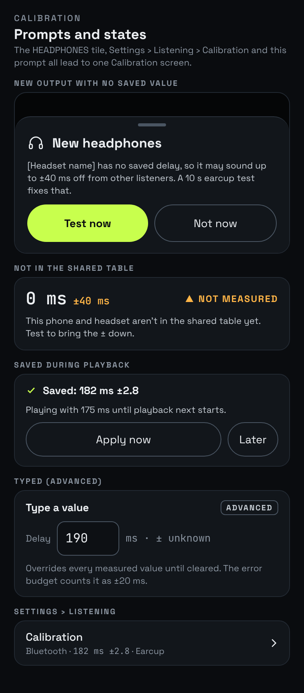

| Item | Shows | Taps |
|---|---|---|
| New headphones | A bottom sheet when an output with no saved value starts playing: name, that it may sound up to ±40 ms off, and the 10 s fix. Once per output. | Test now, Not now |
| Not in the shared table | `0 ms ±40 ms`, ▲ amber `NOT MEASURED`, and a line asking for a test | |
| Saved during playback | See Applying a value above | Apply now, Later |
| Typed (advanced) | A number field in ms, `± unknown`, and that it overrides every measured value until cleared | |
| Settings row | See Settings › LISTENING · Calibration | Opens Calibration |

## Test bench (prototype)

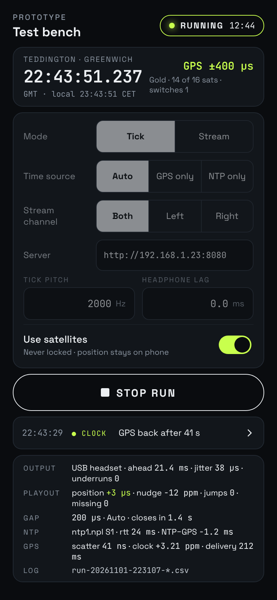

This screen restyles today's test controls with the same data.

- **Locked while running:** Mode, Time source, Stream channel, Server, Tick pitch and Headphone lag.
- **Never locked:** Use satellites.
- **Status grid:**
  - OUTPUT: `Playout`
  - PLAYOUT: `Renderer`
  - GAP: `NudgeControl`
  - NTP: `NtpClient`
  - GPS: `GpsTime`, `FlowTime.gps.slope`
  - LOG: `Session.name`

## Notification, lock screen and quick settings

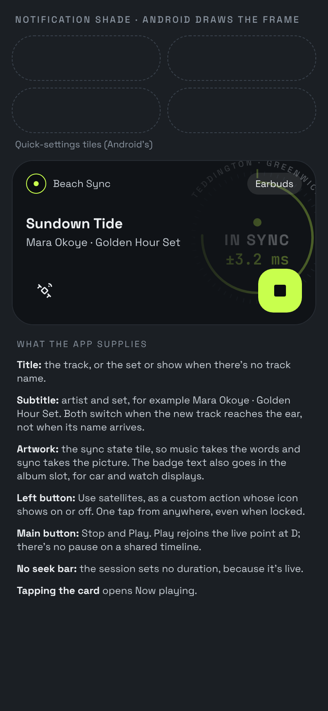 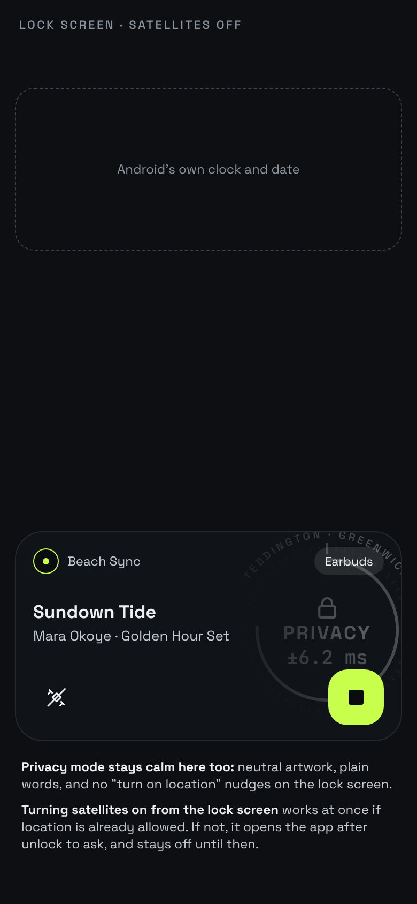

Android draws all three from one `MediaSession` and its media notification. The app supplies only the content below. Use Android's media style and don't design a custom notification layout. (The foreground service that keeps playback alive with the screen off is code; see `feedback.md`.)

| Slot | Content | Source | Updates |
|---|---|---|---|
| Title (`METADATA_KEY_TITLE`) | The track, for example `Sundown Tide`; falls back as in the Track names rule | Stream track metadata | At heard time (Track names rule) |
| Subtitle (`METADATA_KEY_ARTIST`) | `artist · set`, for example `Mara Okoye · Golden Hour Set` | Stream track metadata | At heard time |
| Album (`METADATA_KEY_ALBUM`) | Badge words, the ± figure and the source, for example `In sync ±3.2 ms · GPS`. Car and watch displays show it. | The badge state and sync error | Only under the redraw rule below |
| Artwork (`METADATA_KEY_ART`) | A 512 × 512 state tile, rendered by the app (`screens/notification-art.png`) | Badge state, ± figure | Only under the redraw rule |
| Playback state | `STATE_PLAYING` or `STATE_STOPPED`; no duration, so no seek bar | `Playout.state` | On change |
| Main button | Stop or Play. Play rejoins the live point at D; there's no pause. | | |
| Custom action 1 | **Use satellites:** icon on (Material Symbols `satellite_alt`) or off (the same icon crossed through). Label `Satellites on` or `Satellites off (Privacy mode)`. | `GpsTime.active` | On change |
| Content intent | Opens Now playing | | |

**Redraw rule:** update the album text and artwork only when the badge state changes, or when the ± figure moves a step (1, 2, 5, 10, 20 ms) and holds it for 10 s. Never update every second.

**Artwork tile:** a dark ground (`bg`), the tick ring, the meridian tick and the `TEDDINGTON · GREENWICH` bezel, a static arc, the state mark, the state word, and the ± figure. Use the state's colour from `tokens.color.status`. Keep everything that matters in the middle 60%, because Android crops it and lays a scrim over it. Privacy mode is neutral at any error. Not in sync has no arc.

**Lock screen:** no nudges to turn location on. If location isn't allowed yet, the satellites button opens the app after unlock to ask, and stays off until then.

## Test bench states

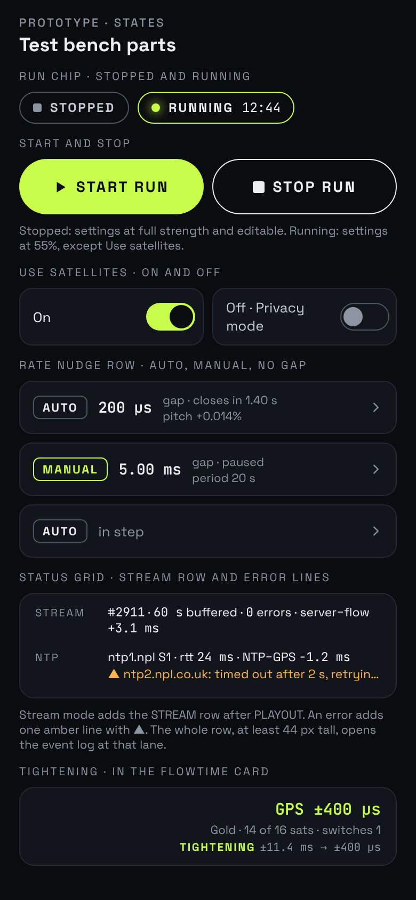

| Part | Design |
|---|---|
| Run chip | STOPPED: an outline in `faint`, text in `textSecondary`, a square mark. RUNNING: an accent outline, a glowing dot, and elapsed `mm:ss`. |
| Start / Stop | START RUN: filled accent with dark text and a ▶. STOP RUN: a `text` outline with a ■. Both 52 high and full width. |
| Settings | 100% opacity and editable while stopped; 55% and locked while running. Use satellites is never locked. |
| Satellites switch, off | Track: a 1.5 px outline in `faint`; thumb: 18 px in `muted`, on the left. On: an accent track with a 22 px thumb in `bg`, on the right. The same on every screen. |
| Rate nudge row | A 48 px row: the mode chip (AUTO outlined in `faint`; MANUAL outlined and lettered in accent), the gap value in 14 px mono, two 11 px lines (`Dragging · Catching-up, 1.40 s` over `pitch +0.014%`; Manual and paused: `gap · paused` over `period 20 s`), then a chevron. No gap: the value reads `in step` in `muted`, with no small lines. Opens Nudge control. The same row appears on Now playing. |
| STREAM row | Stream mode only, after PLAYOUT: newest segment, seconds buffered, fetch errors, server−flowtime |
| Error lines | One extra line under the row, in `warn` with ▲, cut to one line. The **whole status row** (label, value and error line) is the tap target, at least 44 px tall. It opens the event log at that row's lane: OUTPUT opens AUDIO, NTP and STREAM open NET. The row always shows the latest error text. If the text changes while the error continues, the log adds a line (`still failing: …`). |
| Tightening | One line under the source detail in the flowtime card: `TIGHTENING` in accent, then `±from → ±to` in `muted` mono. Only under the tightening rule. |

---

## Screen levels

Each phone moves between levels automatically, based on heat, missed frames, underruns and battery. The level is always named on screen (`SCREEN · MINIMAL` in the screen's corner), along with the reason. Levels never change the audio.

| Level | Every screen |
|---|---|
| Full | As drawn |
| Reduced | No glows, no sweep, and no animated hand-overs. Clocks update to 0.1 s at 4 Hz, traces at 1 Hz. |
| Minimal | Pure black, text only, one update a second, no animation. The clock shows whole seconds, the badge is words, the event log is plain text, and the satellites switch stays. See `screens/now-playing-minimal.png`. |
| Off | Screen off. The notification and lock-screen player carry the state (see Notification, lock screen and quick settings). |

The light show follows its own rules. A screen level can reduce flashes but can never start the show without the listener's opt-in. The three-flashes limit and the "no flashing" setting always apply.
